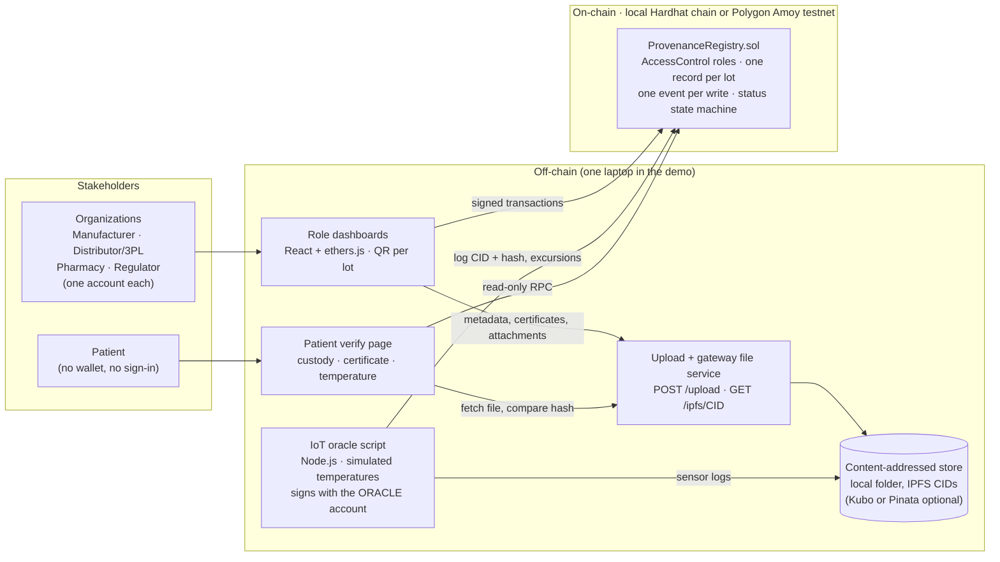
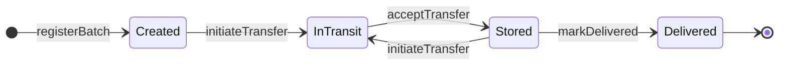

# Tamper-Evident Pharmaceutical Cold-Chain Provenance

[](https://github.com/Srijan2601/cse540-pharma-provenance/actions/workflows/ci.yml)

A shared, tamper-evident record of a prescription drug lot's **custody, temperature condition and certification**. Rival supply-chain companies write to it, each limited to its own role, and **anyone, including a patient with no wallet, can verify a lot** by scanning a QR code.

**CSE 540: Engineering Blockchain Applications · Project Group 2 · Fall 2026**

Solidity 0.8 · Hardhat 3 · OpenZeppelin AccessControl · React + ethers.js · IPFS content addressing · Polygon Amoy testnet

> **Status: final submission. Deployed on the Polygon Amoy testnet** at [`0x603E9669D24BFf7c073ECcea36d203A453d49664`](https://amoy.polygonscan.com/address/0x603E9669D24BFf7c073ECcea36d203A453d49664), where the full terminal demo has run ([details](#polygon-amoy)). The whole system (contract, IoT oracle, file service, web app) can also run on one laptop against a local Hardhat chain, with no account, private key or wallet extension: that is the quickest way to try it, and the backup if the testnet is unavailable.

**Contents:** [Quick start](#quick-start) · [Where to look when grading](#where-to-look-when-grading) · [Demo walkthrough](#demo-walkthrough) · [The problem](#the-problem) · [How it works](#how-it-works) · [Where each promised feature lives](#where-each-promised-feature-lives) · [Repository layout](#repository-layout) · [Commands](#commands) · [Testing](#testing) · [Polygon Amoy](#polygon-amoy) · [Configuration](#configuration) · [Design decisions](#design-decisions-and-trust-assumptions) · [Contributing](#contributing) · [Team](#team) · [References](#references-and-license)

## Quick start

You need Node.js 22.13 or newer (it includes npm), Git and a browser. Nothing else: no wallet, no account, no `.env` file. The internet is needed only by `npm run setup`, which downloads the packages and the Solidity compiler (about 15 seconds on the laptop this was checked on, starting with empty caches).

```bash
git clone https://github.com/Srijan2601/cse540-pharma-provenance.git
cd cse540-pharma-provenance
npm run setup          # once: installs the three packages from their lockfiles, compiles the contracts
npm start -- --seed    # local chain, contract, roles, file service, five demo lots, web app
```

A few seconds later (about five on the laptop this was checked on) the terminal prints a summary, shortened here, and stays in the foreground until Ctrl+C:

```text
  Open
    Web app         http://localhost:5173
    Verify lot 1    http://localhost:5173/#/verify?lot=1
  Local test accounts (Organization dashboard > Local test account; no wallet needed)
    #0  Regulator    0xf39Fd6e51aad88F6F4ce6aB8827279cffFb92266
    ...              #1 Manufacturer, #2 Distributor, #3 Pharmacy, #4 IoT oracle, #6 Distributor
  Seeded lots
    1  Delivered    certified; at the pharmacy; 3 sensor logs; 2 attachments, one of them encrypted
    2  InTransit    hand-off from the manufacturer to the distributor is open; not certified
    3  Compromised  certified; at the distributor; an excursion of 9.0 C was reported
    4  Recalled     certified; recalled by the regulator while at the distributor
    5  Stored       at the pharmacy; not certified; 2 sensor logs
    Key for lot 1's encrypted attachment (certificate-of-analysis.txt):
      <43 characters, a new key on every start>
```

Three things to try next:

| Try | How | You should see |
|---|---|---|
| The patient's view | Open <http://localhost:5173> and click **Lot 1**. No sign-in. | "Record verified", seven files each marked "Matches the … fingerprint", the custody history, the temperature chart and the QR code. |
| A cold-chain failure | Open the page of **Lot 5**, then in a second terminal: `npm run oracle:once -- --lot 5 --scenario excursion` | Within a few seconds, without reloading, the page changes to "Do not use: a temperature excursion was recorded". |
| The whole contract in a terminal | `npm run demo` (needs nothing running) | 19 steps with two lots: every role acts, and 26 calls that must fail are refused with the name of their custom error. |

* Ctrl+C stops the chain, the file service and the web app and checks that ports 8545, 8787 and 5173 are free. The chain lives in memory, so every start is a new chain with new lots.
* `npm run setup` prints two `npm warn deprecated` lines (`inflight`, `glob`). They come from a development-only dependency of the Hardhat toolbox and affect nothing. Do not run `npm audit fix --force`.
* All of this was checked on macOS with Node.js 22.18, and on 2026-11-25 again on Fedora Linux with Node.js 22.23.1. It was not tried on Windows.

## Where to look when grading

| Criterion | Where it is addressed |
|---|---|
| Functional completeness against the proposal | [Where each promised feature lives](#where-each-promised-feature-lives): each proposal item, its code and how to show it, then what is not done |
| Smart contract quality | [`contracts/README.md`](contracts/README.md): one contract built from a base and three modules, roles, transition table, events, the 17 custom errors, invariants. Every function of [`IProvenanceRegistry.sol`](contracts/interfaces/IProvenanceRegistry.sol) has NatSpec. |
| Stakeholder interactions and transactions | [Demo walkthrough](#demo-walkthrough) (every role in the web app) and `npm run demo` (every role, and 26 refused calls, in a terminal) |
| Testing and error handling | [Testing](#testing) and [`docs/testing/README.md`](docs/testing/README.md); each custom error is asserted by name in `test/unit/` |
| Documentation and code comments | this README, the READMEs of [`contracts/`](contracts/README.md), [`oracle/`](oracle/README.md), [`frontend/`](frontend/README.md) and [`deployments/`](deployments/README.md), and [`docs/design-decisions.md`](docs/design-decisions.md), whose identifiers are cited in code comments; every file in `scripts/` starts with a comment that explains it |

## Demo walkthrough

A script for the demo video: two terminals in the repository folder and one browser. To switch organizations, open **Organization dashboard** and pick another entry in **Local test account**. The local node signs for these accounts, so there is nothing to unlock. Reloading a page signs you out; pick the account again.

1. **Start.** Terminal 1: `npm start -- --seed`, then open <http://localhost:5173>.
   *See:* the summary above; the home page lists lots 1 to 5 as Delivered, In transit, Compromised, Recalled and Stored.
2. **Patient, no sign-in.** Click **Lot 1**.
   *See:* "Record verified. Delivered by the pharmacy."; seven files, each with "Matches the … fingerprint"; ten history entries rebuilt from events; the temperature chart; **This lot's QR code**.
3. **Encrypted attachment.** Under **Attachment: certificate-of-analysis.txt**, paste the key from the terminal summary into **Key** and click **Decrypt and download**.
   *See:* "Decrypted. "certificate-of-analysis.txt" was saved to your downloads." A wrong key gives "Decryption failed".
4. **Regulator onboards an organization.** Sign in as **#0 · Regulator**. In **Organizations**, paste `0x14dC79964da2C08b23698B3D3cc7Ca32193d9955` (test account #7), choose **Distributor**, click **Grant role**.
   *See:* "Distributor role granted to 0x14dC…9955." and a new row in the table of role holders.
5. **Manufacturer registers a lot.** Sign in as **#1 · Manufacturer**. Fill in every field of **Register a lot**, both dates included (only the range 2.0 to 8.0 °C is prefilled), attach any small file, tick **Confidential: encrypt before upload**, click **Register lot**.
   *See:* "Lot 6 is registered.", the lot's QR code, and the key of the attachment, which is shown only once.
6. **A blocked action.** In **My lots**, on Lot 6: **Start hand-off** → **Another address…** → paste the pharmacy's address `0x90F79bf6EB2c4f870365E785982E1f101E93b906` → **Start hand-off**.
   *See:* "0x90F7…b906 cannot receive this lot. A manufacturer hands a lot to a distributor; …". This is the contract's `InvalidRecipient` error, found by simulating the call; no transaction is sent.
7. **Hand-off, first half.** In the same form choose **Distributor · 0x3C44…93BC (test account #2)** and click **Start hand-off**.
   *See:* Lot 6 is "In transit" with "hand-off open to Distributor 0x3C44…93BC". The manufacturer still holds it.
8. **Distributor accepts and moves the lot.** Sign in as **#2 · Distributor**. On Lot 6: **Accept hand-off**, **Mark as in transit**, **Mark as stored**, then **Start hand-off** → **Pharmacy · 0x90F7…b906 (test account #3)**.
   *See:* "Hand-off accepted. This account now holds the lot.", two status updates, then an open hand-off to the pharmacy.
9. **Pharmacy accepts, delivers and verifies.** Sign in as **#3 · Pharmacy**. On Lot 6: **Accept hand-off**, **Mark delivered**, then **Verify**.
   *See:* the verify page of lot 6: "Record verified. Delivered by the pharmacy.", its eight history entries, and the note "No regulator certificate has been issued for this lot."
10. **Regulator certifies.** Sign in as **#0 · Regulator**. Under **All lots**, on Lot 6: **Issue certificate**, fill in the four fields, click **Issue certificate**, then **Verify page**.
    *See:* "Certificate uploaded and recorded for this lot."; the verify page now shows the certificate with "Matches the on-chain fingerprint", and the note is gone.
11. **IoT oracle, live.** Open the verify page of **Lot 5** in a second browser tab and leave it open. Terminal 2: `npm run oracle:once -- --lot 5 --scenario excursion`
    *See:* an `EXCURSION … status=Compromised` line in the terminal. Within about five seconds, without a reload, the page shows "Do not use: a temperature excursion was recorded" and the reading on the chart.
12. **Regulator recalls.** In the first tab, click **Organization dashboard** (you are still **#0 · Regulator**: moving around the app keeps the sign-in), then under **All lots**, on Lot 5: **Recall**, type a reason, **Recall lot…**, **Confirm recall**.
    *See:* "Lot recalled. Its verify page now tells people not to use it."; the page of lot 5 in the second tab changes to "Do not use: recalled by the regulator" with the reason.
13. **A tampered file.** Open the verify page of Lot 1, open **Technical details** under **Lot metadata** and copy the CID. Terminal 2: `echo tampered >> oracle/.ipfs-store/<CID>`. Reload the page.
    *See:* "Record problem: a file does not match its fingerprint", and "DOES NOT MATCH the on-chain fingerprint" for the lot metadata, whose content is no longer shown. Terminal 1 logs each refused download as `[files] … GET /ipfs/<CID> 500`; that is expected.
14. **The contract alone.** Ctrl+C in terminal 1 ("Stopped. Ports 8545, 8787, and 5173 are free."), then `npm run demo`.
    *See:* the terminal-only walkthrough: 25 transactions marked `OK`, 26 refused calls marked `BLOCKED`, then the patient's view of both lots rebuilt from events. `PAUSE=1 npm run demo` waits for Enter between steps.

Notes for the recording:

* **QR code on a phone (optional).** `npm start -- --seed --lan` also listens on the local network and makes the QR codes point at the laptop's address; the summary prints that address. It was checked by opening that address in a browser on the same laptop, **not with a real phone**. Use it only on a network you trust: the test accounts and the upload endpoint are then open to every device on it. Decrypting an attachment does not work through that address, because browsers offer the needed API only on `https` or `localhost`, so the page asks you to decrypt on the laptop itself; the fingerprint checks work on both.
* **More oracle.** `SIM_SAMPLE_SECONDS=5 npm run oracle` watches every active lot and anchors one sensor log per lot a minute until Ctrl+C. `--scenario spike` records one out-of-range reading without reporting an excursion, because the rule needs three in a row.
* Nothing needs to be undone after step 13: the next start creates a new chain and new files.

## The problem

A drug lot moves from a **manufacturer** through **distributors** to a **pharmacy**, and each one keeps its own records. Nobody, least of all the patient, can verify a lot's custody, temperature history or certification. So counterfeits enter at hand-offs, temperature excursions go hidden, and recalls stall. About 1 in 10 medical products in low- and middle-income countries is substandard or falsified [1]. The FDA keeps extending U.S. electronic drug-tracing deadlines because sharing data between many parties is hard [2].

**Why a blockchain:** rival firms share one record that none of them controls; signed, hash-linked transactions make the history tamper-evident; anyone can audit it; a smart contract enforces one set of rules. The design targets a **public** chain so patients can verify lots without joining a consortium (unlike permissioned Hyperledger Fabric, which the report only compares against).

## How it works



Off-chain files are linked on-chain by content, so a later edit is detectable. A CID is not a plain hash of a file's bytes, so the contract stores the CID (to find the file) **and** `keccak256` of the bytes (to check it). The file service sits between the web app and storage so that a storage credential never reaches the browser. By default it needs none: files go to a local folder and are named by the CID that IPFS gives a single-block file (up to 256 KiB; [`oracle/README.md`](oracle/README.md) records the comparison with a real IPFS node).

| # | Data flow | On-chain call(s) |
|---|---|---|
| 1 | **Register:** the manufacturer's browser builds the lot-metadata file, encrypts a confidential attachment, uploads both and registers the lot with the returned CID and hash | `registerBatch` |
| 2 | **Hand off:** each transfer is a signed initiate/accept pair naming the new custodian; the sender can cancel until it is accepted | `initiateTransfer` → `acceptTransfer` (`cancelTransfer`) |
| 3 | **Monitor:** the oracle stores a sensor-log file and anchors it; three consecutive out-of-range readings are reported and flag the lot **Compromised** | `anchorSensorLog`, `reportExcursion` |
| 4 | **Oversee:** the regulator onboards organizations and can certify or recall a lot | `grantRole` / `revokeRole`, `issueCertificate`, `recallBatch` |
| 5 | **Verify:** the patient scans the QR code; the page reads the lot and its events over read-only RPC and checks every file against its on-chain hash | `verifyBatch` + event logs |

### Actors and roles (proposal Table I)

| Actor | Contract role | Main functions | In the demo |
|---|---|---|---|
| Manufacturer | `MANUFACTURER_ROLE` | `registerBatch`, `initiateTransfer` | dashboard, account #1 |
| Distributor / 3PL | `DISTRIBUTOR_ROLE` | `acceptTransfer`, `updateStatus`, `initiateTransfer` | dashboard, accounts #2 and #6 |
| Pharmacy | `RETAILER_ROLE` | `verifyBatch`, `acceptTransfer`, `markDelivered` | dashboard, account #3 |
| Regulator | `REGULATOR_ROLE` (admin) | `grantRole`, `issueCertificate`, `recallBatch` | dashboard, account #0 |
| IoT oracle | `ORACLE_ROLE` | `anchorSensorLog`, `reportExcursion` | `npm run oracle`, account #4 |
| Patient | none (no wallet) | read-only `verifyBatch` via QR code | verify page |

### Lot lifecycle



Not shown in the diagram:

* An active lot (**Created, InTransit or Stored**) becomes **Compromised** when the oracle reports a reading outside the range registered for the lot. The contract checks the reading against that range.
* The regulator can **recall** a lot in any status except Recalled. Delivered, Compromised and Recalled are terminal for custody, and Recalled is final.
* `cancelTransfer` returns a lot to the status it had before the hand-off; `updateStatus` lets a distributor switch its own lot between InTransit and Stored.
* A role is not enough for a custody action: the caller must also be the lot's custodian, or the named recipient for `acceptTransfer`. A manufacturer hands off to a distributor; a distributor to a distributor or a pharmacy.
* Entering Compromised or Recalled closes an open hand-off, so a flagged lot cannot change hands.

The full transition table, the 17 custom errors and the invariants I1 to I5 are in [`contracts/README.md`](contracts/README.md#function--transition--event-c1).

## Where each promised feature lives

| Proposal item | Code | Show it with |
|---|---|---|
| One `ProvenanceRegistry` contract (Solidity 0.8.x, OpenZeppelin `AccessControl`, Hardhat); one record per lot, unique IDs | [`contracts/ProvenanceRegistry.sol`](contracts/ProvenanceRegistry.sol) = [`base/RegistryBase.sol`](contracts/base/RegistryBase.sol) + three modules; API in [`interfaces/IProvenanceRegistry.sol`](contracts/interfaces/IProvenanceRegistry.sol) | `npm run compile`, `npm test` |
| Manufacturer: `registerBatch`, `initiateTransfer` | [`contracts/modules/CustodyModule.sol`](contracts/modules/CustodyModule.sol); `frontend/src/components/dashboard/RegisterLotForm.jsx`, `LotRow.jsx` | walkthrough steps 5 to 7 |
| Distributor: `acceptTransfer`, `updateStatus`, `initiateTransfer` | `CustodyModule.sol`; `frontend/src/components/dashboard/LotRow.jsx` | step 8 |
| Pharmacy: `verifyBatch`, `acceptTransfer`, `markDelivered` | `RegistryBase.sol` (views), `CustodyModule.sol`; `CustodyPanels.jsx`, `LotRow.jsx` | step 9 |
| Regulator: grant roles, `issueCertificate`, `recallBatch` | role hierarchy in the constructor of `RegistryBase.sol`; [`CertificationModule.sol`](contracts/modules/CertificationModule.sol); `RegulatorPanel.jsx` | steps 4, 10, 12 |
| IoT oracle: `anchorSensorLog`, `reportExcursion` | [`ConditionModule.sol`](contracts/modules/ConditionModule.sol); `oracle/src/oracle/` | step 11 |
| An event per write: the eight of Fig. 1, plus `TransferCancelled` | `IProvenanceRegistry.sol` | `npm run demo` (history from events); `test/integration/event-history.test.js` |
| Role-based access control; invalid or unauthorized calls revert | `onlyRole` / `onlyEitherRole` and the guards in `RegistryBase.sol`; 17 custom errors | step 6; the `BLOCKED` lines of `npm run demo`; `test/unit/AccessControl.test.js` |
| Status state machine | the three modules; invariants I1 to I5 in `RegistryBase.sol` | `test/unit/StateMachine.test.js`, `test/solidity/RandomWalk.t.sol` |
| IPFS for certificates, metadata and sensor logs | `oracle/src/ipfs/`, `oracle/src/service/`: by default a local folder of files named by their IPFS CIDs, with no IPFS node (Kubo or Pinata optional); formats in [`docs/schemas/`](docs/schemas/README.md) | steps 5, 10, 11 |
| Verify page checks files against on-chain hashes | `frontend/src/chain/files.js`, `frontend/src/lib/lotDocuments.js`, `verdict.js` | steps 2 and 13 |
| Encrypting confidential documents before upload | `oracle/src/crypto/envelope.js` (AES-256-GCM), run in the browser by the register form | steps 3 and 5 |
| Simulated sensors; oracle script signing with the ORACLE account | `oracle/src/simulator/`, `oracle/src/oracle/` | step 11; `npm run oracle` |
| Role dashboards (React + ethers.js) | `frontend/src/pages/DashboardPage.jsx`, `frontend/src/components/dashboard/` | steps 4 to 12 |
| QR code per lot | `frontend/src/components/QrCode.jsx`, `frontend/src/lib/verifyLink.js` | steps 2 and 5 |
| Patient verify page: custody, certificate, temperature log | `frontend/src/pages/VerifyPage.jsx`, `frontend/src/components/verify/` | step 2 |
| Tests | `test/`, `oracle/test/`, `frontend/src/lib/*.test.js` | [Testing](#testing) |
| Measured gas data for the analysis | `scripts/gas-report.js` → [`docs/analysis/data/gas-report.md`](docs/analysis/data/gas-report.md) | `npm run gas:report` |
| Contingency: demo on a local Hardhat network | `scripts/stack.js` | `npm start -- --seed` |

**Not in this repository, or not done:**

* **Polygon Amoy is deployed but only partly exercised.** The registry is deployed and `npm run demo:amoy` ran once on the real network (see [Polygon Amoy](#polygon-amoy)). The verify page was opened against it once and loaded a lot's record and history; its files were not available, because the terminal demo does not upload them. The dashboards, the oracle program and file storage were not run against Amoy, and the source is not verified on PolygonScan (`npm run verify:amoy` was not run).
* **Not verified:** signing in with MetaMask (the button exists; every check used the local test accounts), and the verify page on a real phone.
* **No public hosting** of the verify page, and no public IPFS pinning: the Pinata back end has never been run against the live service, and Kubo is optional.
* **No browser test suite.** The screens were checked by hand and with a scripted headless browser; the logic behind them has unit tests.
* **Stretch goals not built:** package-level serial numbers and ERC-721 lot tokens. Real sensors were out of scope from the start.
* **The written analysis** (gas cost, scalability, privacy, regulation, centralized comparison) is in the report, which is submitted separately. This repository supplies the measured gas data.

## Repository layout

```text
contracts/
  interfaces/IProvenanceRegistry.sol   the API: types, events, custom errors, every function with NatSpec
  base/RegistryBase.sol                roles, storage and its invariants, shared guards, read-only views
  modules/CustodyModule.sol            registerBatch, initiateTransfer, acceptTransfer, cancelTransfer, updateStatus, markDelivered
  modules/ConditionModule.sol          anchorSensorLog, reportExcursion
  modules/CertificationModule.sol      issueCertificate, recallBatch
  ProvenanceRegistry.sol               the one deployed contract: composes the three modules
  README.md                            roles, data model, transition table, errors, invariants, trust assumptions
test/
  unit/                                one function or rule at a time; role x function and status x function matrices
  integration/                         whole journeys: data flows 1 to 5, exceptions, history rebuilt from events
  solidity/                            fuzz and invariant tests run by Hardhat's Solidity test runner
  tooling/                             committed ABI and gas report match the code; CID helper
  helpers/                             fixtures and assertions shared by the Mocha tests
scripts/
  stack.js                             npm start: chain, deploy, roles, file service, optional demo lots, web app
  demo.js                              terminal walkthrough of the whole contract (local, or single-wallet on Amoy)
  deploy.js, grant-roles.js            deploy and write deployments/<network>.json; onboard organizations
  gas-report.js, export-abi.js         gas tables for the analysis; ABI export after every compile
  test-subset.js, lib/                 runs one test folder; helpers (seed lots, demo documents, fees, derived wallets)
oracle/                                own npm package: storage, file service, encryption, documents, simulator, IoT oracle
frontend/                              own npm package: React app with the dashboards and the patient verify page
deployments/                           abi/ProvenanceRegistry.json (committed); <network>.json per deployment (localhost.json is not committed)
docs/
  design-decisions.md                  what the proposal left open and what the code does about it
  schemas/                             JSON Schemas and synthetic examples of the three off-chain documents
  testing/README.md                    the test plan as implemented
  analysis/data/                       gas-report.json and gas-report.md, generated
  README.md, meetings/TEMPLATE.md      docs index; template for meeting notes
.github/                               CI workflow (contracts, oracle, frontend) and the pull-request template
hardhat.config.js                      Solidity 0.8.34, EVM target cancun, optimizer on; networks: in-process, localhost, amoy
package.json, package-lock.json        Hardhat 3, OpenZeppelin Contracts 5, mocha, chai, ethers 6
LICENSE                                MIT
.env.example, .gitignore               template for the optional Amoy variables (Configuration below is the reference list); nothing here needs a .env file
```

## Commands

All of these run in the repository root.

| Command | What it does |
|---|---|
| `npm run setup` | Installs the root, `oracle/` and `frontend/` packages from their lockfiles and compiles the contracts. Run once. |
| `npm start` | Starts the local chain (port 8545), deploys the registry, grants roles to test accounts #1 to #4, starts the file service (8787) and the web app (5173), and prints a summary. Ctrl+C stops everything. |
| `npm start -- --seed` | The same, plus five demo lots with real documents and account #6 as a second distributor. Add `--lan` to make it reachable from the local network. |
| `npm run oracle:once -- --lot <id>` | The oracle anchors one sensor log for one lot now. `--scenario normal` (default), `excursion`, `freeze` or `spike`. Needs `npm start` running. |
| `npm run oracle` | The oracle watches every active lot until Ctrl+C. `SIM_SAMPLE_SECONDS=5` gives one log per lot a minute instead of one every 12 minutes. |
| `npm run demo` | The terminal walkthrough of the whole contract on a throwaway in-process chain. |
| `npm run demo:local` | The same walkthrough against the chain started by `npm start`. It can be repeated: every run registers two new lots. |
| `npm test` | All contract tests. Subsets: `npm run test:unit`, `test:integration`, `test:solidity`, `test:tooling`. |
| `npm run coverage` | The tests with line and statement coverage of `contracts/`. |
| `npm run test:gas` | The Mocha tests with Hardhat's table of gas per function. |
| `npm run gas:report` | Measures every transaction and whole lot lifecycles, and writes `docs/analysis/data/gas-report.json` and `.md`. |
| `npm run compile` | Compiles the contracts and exports the ABI to `deployments/abi/` (`npm run abi:export` does the export alone). |
| `npm run clean` | Deletes Hardhat's build output (`artifacts/`, `types/`, the compile cache in `cache/`) and `coverage/`; `deployments/` and the oracle's file store are kept. `npm run compile` rebuilds the build output. |
| `npm run node`, `npm run deploy:local`, `npm run roles:local` | The first three steps of `npm start`, by hand: a local chain, a deployment written to `deployments/localhost.json`, and the roles for accounts #1 to #4. `npm run node` prints the private keys of the test accounts. They are publicly known: never use them on a real network. |
| `npm run deploy:amoy`, `demo:amoy`, `roles:amoy`, `verify:amoy` | Polygon Amoy only; see [below](#polygon-amoy). |

The two sub-packages have their own commands: [`oracle/README.md`](oracle/README.md) (file service, storage and document tools, simulator, oracle options) and [`frontend/README.md`](frontend/README.md) (development server, build, settings).

## Testing

Counts from runs on 2026-11-25. Every test passed.

| Suite | Command | Result |
|---|---|---|
| Contract | `npm test` | 495 passing: 490 Mocha (462 unit, 17 integration, 11 tooling) and 5 Solidity fuzz tests |
| Contract coverage | `npm run coverage` | 100% of lines and statements in the four contract files that contain code. The tool does not measure branches, and a coverage run skips the two gas-report checks. |
| Oracle | `cd oracle && npm test` | 523 passing |
| Oracle against the real contract | `cd oracle && npm run test:e2e` | 3 passing in about 13 seconds; starts its own Hardhat node on a free port |
| Web app | `cd frontend && npm test` | 190 passing in 11 files |

The contract tests check every function's success path with its event and every revert with its custom error, a role × function matrix, a status × function matrix, the invariants I1 to I5 after every call of a seeded 500-call random walk (Mocha) and after every step of 64 random walks of 150 steps (Solidity), and whole journeys across roles. The oracle and web-app tests cover their logic without a chain or a browser; the screens themselves have no automated test. The plan, layer by layer, is in [`docs/testing/README.md`](docs/testing/README.md).

## Polygon Amoy

The project's target network is the public Polygon Amoy testnet. The local chain above is the backup: it needs no network, wallet or test POL. This section deploys the same contract to Amoy and runs the terminal demo there, all from **one** free testnet wallet.

**What was run.** On 2026-11-26 (Arizona time), steps 1 to 5 below were run on the real network from Fedora Linux, with a new wallet funded with 1 POL from the faucet. The deployment and one run of `npm run demo:amoy` succeeded: 29 transactions sent and 26 refused calls simulated, the same steps as the local demo. Before that, on 2026-11-25, the same steps and `npm run roles:amoy` had been run against a local stand-in (a Hardhat node given Amoy's chain id, 80002). `npm run roles:amoy` and `npm run verify:amoy` have not been run on the real network.

1. Create a new wallet used for nothing else and get test POL for it from an Amoy faucet. Test POL is free. <https://faucet.polygon.technology> worked on 2026-11-26: it asks you to sign in with GitHub or X, and the POL arrived within a few minutes. Faucets that ask for a balance on a real network can be skipped.
2. Store the endpoint and the key in Hardhat's encrypted keystore, a password-protected file in your user profile, outside the repository. The first command asks you to choose a password; every later Amoy command asks for it.
   ```bash
   npx hardhat keystore set AMOY_RPC_URL           # paste https://polygon-amoy-bor-rpc.publicnode.com
   npx hardhat keystore set DEPLOYER_PRIVATE_KEY   # paste the wallet's private key (input is hidden)
   ```
3. `npm run deploy:amoy` prints the transaction hash and the registry's address as soon as the transaction is sent, then writes `deployments/amoy.json`.
4. `npm run demo:amoy` runs the walkthrough of `npm run demo` in single-wallet mode. Your wallet is the regulator; the other actors are throwaway wallets derived from it, topped up automatically. Refused calls are simulated and cost nothing. Every transaction prints its `amoy.polygonscan.com` link. Step 0 prints the cost and stops, before anything is sent, if the balance is too low.
5. Commit `deployments/amoy.json` and fill in the table below.

**Cost.** Measured on the real network on 2026-11-26: the deployment was sent at a gas price of 56 gwei and cost about 0.11 POL. The demo run that followed reported 2,308,953 gas and 0.137801 POL in fees for its 29 transactions, at a base fee of 30 gwei plus a priority fee of about 29.7 gwei. Step 0 also moves some POL to the derived wallets; what they do not spend stays there for the next run. On the local stand-in the same run had reported 1,920,885 gas, so for the analysis use the receipts on PolygonScan rather than the stand-in's figures. The first run will not start with less than about 0.25 POL in the wallet, so plan on at least 0.4 POL for the deployment and one run; 0.5 POL or more leaves room for a second run.

**Endpoint.** Use `https://polygon-amoy-bor-rpc.publicnode.com` (no key needed). In a test on 2026-11-25 it answered 40 of 40 requests and accepted event queries of up to 10,000 blocks. `polygon-amoy.drpc.org` answered 31 of 40 and refused every event query over 100 blocks, and the scripts do not retry a failed request. `rpc-amoy.polygon.technology`, which the midterm README named, has been shut down: on 2026-11-25 its name no longer resolved.

### Deployments

| Network | Address | Deploy block | Date |
|---|---|---|---|
| Polygon Amoy (80002) | [`0x603E9669D24BFf7c073ECcea36d203A453d49664`](https://amoy.polygonscan.com/address/0x603E9669D24BFf7c073ECcea36d203A453d49664) | [53923451](https://amoy.polygonscan.com/block/53923451) | 2026-11-26 |

The address is also in `deployments/amoy.json`, which the web app and the oracle read (see [`deployments/README.md`](deployments/README.md), which also explains source verification with `npm run verify:amoy` and a free Etherscan API key).

To show the deployment in the web app, run `npm start` and open <http://localhost:5173/#/verify?lot=1&chain=80002&registry=0x603E9669D24BFf7c073ECcea36d203A453d49664>. The lot's record and history load from Amoy. Its files show as not fetched, because the terminal demo keeps them in memory and never uploads them.

The older multi-wallet path still exists: `npm run deploy:amoy`, then `npm run roles:amoy` with the organizations' own wallet addresses in `MANUFACTURER_ADDRESS`, `DISTRIBUTOR_ADDRESS`, `RETAILER_ADDRESS` and `ORACLE_ADDRESS`.

## Configuration

**The local demo needs no configuration.** The variables below matter only for Polygon Amoy and for the cost columns of the gas report.

| Variable | Read by | Purpose | Secret? |
|---|---|---|---|
| `AMOY_RPC_URL` | `hardhat.config.js` | Amoy JSON-RPC endpoint | only if the URL contains an API key |
| `DEPLOYER_PRIVATE_KEY` | `hardhat.config.js` | key of the one testnet wallet that deploys and, in `demo:amoy`, is the regulator | **yes** |
| `REGULATOR_ADDRESS` | `scripts/deploy.js` | gives the regulator role to another wallet than the deployer; leave it unset for `demo:amoy` | no |
| `MANUFACTURER_ADDRESS`, `DISTRIBUTOR_ADDRESS`, `RETAILER_ADDRESS`, `ORACLE_ADDRESS` | `scripts/grant-roles.js` | the wallets that `npm run roles:amoy` onboards | no |
| `REGISTRY_ADDRESS` | `scripts/grant-roles.js` | overrides the address in `deployments/amoy.json` | no |
| `ETHERSCAN_API_KEY` | `hardhat.config.js` | only for `npm run verify:amoy` | yes |
| `GAS_PRICE_GWEI`, `POL_USD` | `scripts/gas-report.js` | add cost columns in POL and USD to the gas report | no |

`.env.example` is only an example: a template with every variable commented out and no real values. The real `.env`, if you create one, is listed in `.gitignore` and is never pushed to GitHub. Keep the two secrets in the keystore (`npx hardhat keystore set <NAME>`), not in a file. A variable of the same name in your shell or in a `.env` file **overrides the keystore even when it is empty**: with an empty `AMOY_RPC_URL` in the shell, Hardhat stops with "Invalid URL value" and never asks the keystore. On the local chain the scripts ignore the address variables and always use the test accounts. The settings of the oracle and the web app, all optional, are listed in their READMEs.

## Design decisions and trust assumptions

The proposal fixed the architecture and left details open: which function causes which transition, how a hand-off is undone, how a file is checked against the chain, what is encrypted. [`docs/design-decisions.md`](docs/design-decisions.md) lists each question and what the code does about it, including the four the team settled by vote; the identifiers there (C1 to C7, O1 to O6) are the ones used in code comments. The system trusts two keys. The regulator's key grants every role and can recall any lot, and a recall cannot be undone. The oracle's key is trusted for sensor truth: the contract checks that a reported reading is outside the lot's range, not that it was measured. Both are discussed under "Trust assumptions" in [`contracts/README.md`](contracts/README.md#trust-assumptions) and [`oracle/README.md`](oracle/README.md).

## Contributing

Branch from `main`, run the tests of the package you changed, and open a pull request with the template; a teammate reviews every pull request, and CI must pass. A change to the contracts can leave the committed ABI (`deployments/abi/`) and gas report (`docs/analysis/data/`) out of date: run `npm run compile` and `npm run gas:report` and commit the results, or `npm test` fails.

**This repository is public.** Never commit private keys, seed phrases, API tokens, `.env` files, ASU IDs, email addresses, or the proposal / team-contract PDF. Use testnet-only wallets.

## Team

| Member | Role (Team Contract §1) | GitHub |
|---|---|---|
| Shaurya | Project Lead, QA & Docs | [shaurya-asu](https://github.com/shaurya-asu) |
| Abedh Tiwari | Smart Contract Lead | [abedhtiwari14](https://github.com/abedhtiwari14) |
| Srijan Girdhar | Front-End / dApp Lead | [Srijan2601](https://github.com/Srijan2601) |
| Soham Kumar | Off-Chain & IoT Lead | [snola534-alt](https://github.com/snola534-alt) |

Roles are leads, not exclusive owners: everyone codes, writes and presents (Team Contract §2). Weekly sync: Sundays 7–8 PM AZ.

## References and license

1. World Health Organization, "1 in 10 medical products in developing countries is substandard or falsified," 2017.
2. U.S. Food and Drug Administration, "Exemptions under the Drug Supply Chain Security Act," fda.gov, 2026.
3. R. Kamath, "Food traceability on blockchain: Walmart's pork and mango pilots with IBM," *J. Brit. Blockchain Assoc.*, 2018.
4. T. Bocek et al., "Blockchains everywhere: A use-case of blockchains in the pharma supply-chain," *IFIP/IEEE IM*, 2017.
5. A. Musamih et al., "A blockchain-based approach for drug traceability in healthcare supply chain," *IEEE Access*, 2021.

**License:** [MIT](LICENSE). The Solidity sources carry `SPDX-License-Identifier: MIT`. OpenZeppelin Contracts, the one library the contract builds on, is MIT-licensed as well.

Course project for CSE 540 at Arizona State University. Testnet only: not for production or medical use.
