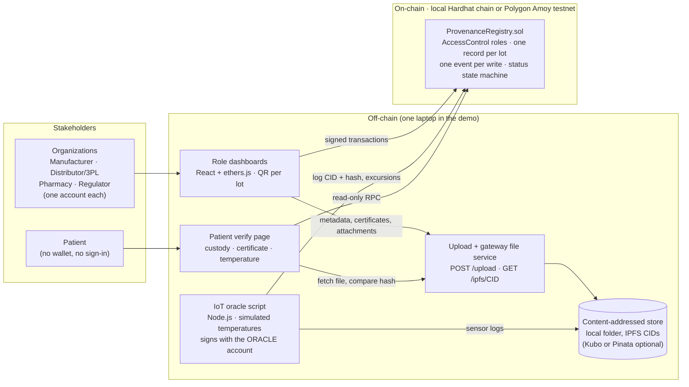
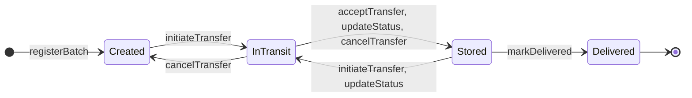
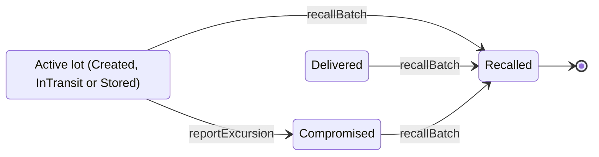

# Tamper-Evident Pharmaceutical Cold-Chain Provenance

[](https://github.com/Srijan2601/cse540-pharma-provenance/actions/workflows/ci.yml)
[](LICENSE)


[](https://amoy.polygonscan.com/address/0x603E9669D24BFf7c073ECcea36d203A453d49664)

A shared, tamper-evident record of a prescription drug lot's **custody, temperature condition and certification**. Rival supply-chain companies write to one smart contract, each limited to the functions of its role, and **anyone, including a patient with no wallet, can verify a lot** by scanning its QR code. Documents and sensor logs stay off-chain under IPFS content identifiers, and the contract stores each file's hash, so a later edit is detected.

**CSE 540: Engineering Blockchain Applications · Project Group 2 · Fall 2026 · Arizona State University**

**Live on Polygon Amoy:** [`0x603E9669D24BFf7c073ECcea36d203A453d49664`](https://amoy.polygonscan.com/address/0x603E9669D24BFf7c073ECcea36d203A453d49664), deployed on 2026-11-26 ([details](#polygon-amoy)).

## Quick start

You need Node.js 22.13 or newer, Git and a browser. No wallet, account, API key or `.env` file.

```bash
git clone https://github.com/Srijan2601/cse540-pharma-provenance.git
cd cse540-pharma-provenance
npm run setup          # once: installs the three packages from their lockfiles and compiles the contract
npm start -- --seed    # local chain, contract and roles, file service, five demo lots, web app
```

Open <http://localhost:5173> and click **Lot 1** for the patient's view. [Setup](#setup) and [Usage](#usage) give the expected output and a 14-step walkthrough of every role, and the [Evaluation guide](#evaluation-guide) maps each grading criterion to its evidence.

## Table of contents

**About the system:** [Overview](#overview) · [Features](#features) · [Architecture](#architecture) · [Stakeholders and transaction flows](#stakeholders-and-transaction-flows) · [Smart contract design](#smart-contract-design)

**Running it:** [Quick start](#quick-start) · [Tech stack and dependencies](#tech-stack-and-dependencies) · [Setup](#setup) · [Usage](#usage) ([start the system](#start-the-system), [demo walkthrough](#demo-walkthrough), [IoT oracle](#iot-oracle), [terminal demo](#terminal-demo)) · [Deployment](#deployment) ([local Hardhat chain](#local-hardhat-chain), [Polygon Amoy](#polygon-amoy)) · [Testing](#testing)

**Reference:** [Project structure](#project-structure) · [Command reference](#command-reference) · [Configuration](#configuration) · [Documentation and code comments](#documentation-and-code-comments) · [Proposal features and where they live](#proposal-features-and-where-they-live) · [Limitations and future work](#limitations-and-future-work) · [Evaluation guide](#evaluation-guide) · [Team](#team) · [Contributing](#contributing) · [License](#license) · [References](#references)

## Overview

**The problem.** A drug lot moves from a manufacturer through distributors to a pharmacy, and each company keeps its own records. Nobody, least of all the patient, can check a lot's custody, temperature history or certification. Counterfeits enter at hand-offs, temperature excursions stay hidden, and recalls stall. About 1 in 10 medical products in low- and middle-income countries is substandard or falsified [1], and the FDA keeps extending U.S. electronic drug-tracing deadlines because sharing data between many parties is hard [2].

**The solution.** One `ProvenanceRegistry` smart contract holds one record per lot: who made it, who holds it now, its status, its allowed temperature range and pointers to its documents. Each organization signs its own transactions and can call only the functions of its role. An IoT oracle anchors temperature logs and flags a lot whose cold chain broke. A regulator certifies and recalls lots. A patient scans the lot's QR code and sees a verdict, the custody history and the temperature log, with every file checked against its on-chain hash.

**Why a blockchain.** Rival firms share one record that none of them controls. Signed, hash-linked transactions make the history tamper-evident, anyone can audit it, and a smart contract enforces one set of rules for everyone. The system targets a public chain, so a patient can verify a lot without joining a consortium. A permissioned chain such as Hyperledger Fabric, which an earlier food-traceability pilot used [3], leaves consumers dependent on its operators. The design builds on earlier work: drug custody on Ethereum with documents on IPFS [5], and temperature checks of drug parcels by a smart contract [4].

## Features

* **One registry, one record per lot.** The contract assigns sequential lot IDs, rejects a duplicate product code and lot number, and each of its ten write functions emits exactly one event.
* **Role-based access control.** Five roles (regulator, manufacturer, distributor, pharmacy, IoT oracle) on OpenZeppelin `AccessControl`. The regulator onboards and offboards organizations. A custody action needs the role and custody of the lot.
* **Two-signature hand-offs.** The sender starts a hand-off and the named recipient accepts it; custody moves only on acceptance. The sender can cancel an open hand-off.
* **Cold-chain monitoring.** The IoT oracle reads simulated temperature sensors, stores each sensor log off-chain and anchors its CID and hash. Three consecutive out-of-range readings trigger an excursion report, the contract checks the reading against the lot's range, and the lot becomes Compromised.
* **Regulator oversight.** The regulator issues certificates and can recall a lot at any stage. A recall is final and closes an open hand-off.
* **Tamper-evident documents.** Lot metadata, certificates and sensor logs are stored under IPFS CIDs. The verify page downloads each file and compares its `keccak256` hash with the one on-chain.
* **Encrypted confidential attachments.** A confidential file is encrypted with AES-256-GCM in the browser before upload. Its key is shown once and is never uploaded.
* **Role dashboards.** A React web app for the manufacturer, distributor, pharmacy and regulator. It offers only the actions the contract would accept, simulates every call before sending it, and explains each custom error in a plain sentence.
* **Patient verify page and a QR code per lot.** No wallet and no sign-in. The page shows a verdict, the lot's facts and documents, the custody history rebuilt from events and a temperature chart, and it refreshes by itself, so an excursion or a recall appears within seconds.
* **One command runs everything.** `npm start` brings up a local chain, the contract with its roles, the file service and the web app. `npm run demo` walks the whole contract in a terminal.
* **Deployed and tested.** The contract is live on Polygon Amoy. 495 contract tests, 523 oracle tests and 190 web-app tests pass, the contract code has 100% line coverage, and CI runs on every pull request and every push to `main`.

## Architecture



### Components

Codes in parentheses such as C3, O1 or D4 name entries in [`docs/design-decisions.md`](docs/design-decisions.md), which records each question the proposal left open, the answer chosen and the reason.

| Component | Where | What it does | Built with |
|---|---|---|---|
| Registry contract | [`contracts/`](contracts/README.md) | The single on-chain record per lot: roles, custody, status, document references, one event per write | Solidity, OpenZeppelin `AccessControl` |
| IoT oracle | [`oracle/src/oracle/`](oracle/README.md#oracle-runner), `oracle/src/simulator/` | Takes simulated temperature readings, applies the excursion rule, stores each sensor log and anchors it with the ORACLE account | Node.js, ethers |
| File service | [`oracle/src/service/`](oracle/README.md#upload--gateway-service), `oracle/src/ipfs/` | Upload endpoint and read gateway in front of a content-addressed store. It holds any storage credential, so the browser never does ([design decision O3](docs/design-decisions.md#off-chain-and-integration-o)) | Node.js (`node:http`) |
| Web app | [`frontend/`](frontend/README.md) | Role dashboards, a QR code per lot and the patient verify page | React, ethers, Vite |
| Scripts | `scripts/` | The `npm start` launcher, the terminal demo, deployment, role grants, the gas report and the ABI export | Node.js, Hardhat |

### On-chain and off-chain data

| Where | What is stored |
|---|---|
| On-chain, in the lot's record | ID, product hash, manufacturer, manufacture date, registration time, custodian, pending custodian, status, allowed temperature range in tenths of a °C, number of sensor logs, and three document references (lot metadata, latest certificate, latest sensor log) |
| On-chain, in events | The lot's whole history: registration, every hand-off, status change, certificate, sensor log, excursion and recall |
| Off-chain, in the content-addressed store | The lot-metadata, certificate and sensor-log JSON documents ([`docs/schemas/`](docs/schemas/README.md)) and attachments, encrypted when confidential |
| Nowhere | Personal data. Encryption keys are shared out of band and never uploaded. |

A document reference is a CID plus `keccak256` of the file's bytes. A CID is not a plain hash of the bytes, so the contract stores the CID to find the file and the hash to check it (design decision O1). By default the file service needs no IPFS node and no account: it keeps files in a local folder under the same CIDv1 that IPFS gives a file of up to 256 KiB, which was checked against a Kubo node ([`oracle/README.md`](oracle/README.md#cids-on-real-ipfs)). Kubo (an IPFS node you run yourself) and Pinata (a hosted IPFS pinning service) are optional back ends.

## Stakeholders and transaction flows

### Roles and permissions

| Stakeholder | Role constant | Functions it can call | Extra condition on the caller | Role granted by |
|---|---|---|---|---|
| Regulator | `REGULATOR_ROLE` and `DEFAULT_ADMIN_ROLE` | `grantRole`, `revokeRole`, `issueCertificate`, `recallBatch` | none | the constructor |
| Manufacturer | `MANUFACTURER_ROLE` | `registerBatch`, `initiateTransfer`, `cancelTransfer` | custodian of the lot, for the two hand-off functions | the regulator |
| Distributor / 3PL (third-party logistics) | `DISTRIBUTOR_ROLE` | `acceptTransfer`, `initiateTransfer`, `cancelTransfer`, `updateStatus` | named recipient for `acceptTransfer`; custodian for the others | the regulator |
| Pharmacy | `RETAILER_ROLE` | `acceptTransfer`, `markDelivered` | named recipient for `acceptTransfer`; custodian for `markDelivered` | the regulator |
| IoT oracle | `ORACLE_ROLE` | `anchorSensorLog`, `reportExcursion` | the lot is active | the regulator |
| Patient, or anyone | none; no wallet | `verifyBatch`, `totalBatches`, `batchIdOf` (read-only) | none | not applicable |

* `REGULATOR_ROLE` administers the four organization roles, and `DEFAULT_ADMIN_ROLE`, held by the regulator, administers `REGULATOR_ROLE`. The deployer gets no role of its own. Any holder can give up its role with `renounceRole`.
* A role is not enough for a custody action (design decision C4). A role says what kind of organization the caller is, not which lots are its own, so the caller must also be the lot's custodian, or the named recipient for `acceptTransfer`.
* Hand-off routes (C3): a manufacturer hands a lot to a distributor; a distributor hands it to another distributor or to a pharmacy.

### Lot lifecycle



An excursion or a recall takes a lot off this path:



* `updateStatus` lets a distributor switch its own lot between InTransit and Stored while no hand-off is open (C1).
* `cancelTransfer` returns the lot to the status it had before the hand-off, Created or Stored. It is not in the proposal's Table I: it was added so that a hand-off the recipient never accepts cannot strand a lot (C3).
* Delivered, Compromised and Recalled end the custody flow, and Recalled is final. The regulator can recall a lot in any status except Recalled: the proposal's "recall a lot at any stage" was chosen over the narrower reading of its Fig. 1 (C2).
* Entering Compromised or Recalled closes an open hand-off, so a flagged lot cannot change hands.

### Data flows

The five data flows of the proposal, with who calls which function and the event each call emits.

| # | Data flow | Who calls | Function | Lot status | Event emitted |
|---|---|---|---|---|---|
| 1 | Register | Manufacturer | `registerBatch` | none → Created | `BatchRegistered` |
| 2 | Hand off | Custodian (manufacturer or distributor) | `initiateTransfer` | Created or Stored → InTransit | `TransferInitiated` |
| | | Named recipient (distributor or pharmacy) | `acceptTransfer` | InTransit → Stored; custody moves | `CustodyTransferred` |
| | | Custodian that opened the hand-off | `cancelTransfer` | InTransit → status before the hand-off | `TransferCancelled` |
| | | Distributor that holds the lot | `updateStatus` | InTransit ⇄ Stored | `StatusUpdated` |
| | | Pharmacy that holds the lot | `markDelivered` | Stored → Delivered | `StatusUpdated` |
| 3 | Monitor | IoT oracle | `anchorSensorLog` | unchanged; active lots only | `SensorLogAnchored` |
| | | IoT oracle | `reportExcursion` | active → Compromised | `ExcursionReported` |
| 4 | Oversee | Regulator | `grantRole`, `revokeRole` | not a lot function | `RoleGranted`, `RoleRevoked` (OpenZeppelin) |
| | | Regulator | `issueCertificate` | unchanged; any status except Recalled | `CertificateIssued` |
| | | Regulator | `recallBatch` | any status except Recalled → Recalled | `BatchRecalled` |
| 5 | Verify | Patient, no wallet | `verifyBatch` and the lot's event logs, over read-only RPC | read-only | none |

Off-chain, flow 1 starts in the manufacturer's browser, which builds the lot-metadata file, encrypts a confidential attachment, uploads both and passes the returned CID and hash to `registerBatch`. In flow 3 the oracle stores each sensor-log file before it anchors it. In flow 5 the verify page downloads every file and compares its hash with the on-chain one.

### Where each role's flows are exercised

| Role | Web app | `npm run demo` steps | Integration tests in `test/integration/` |
|---|---|---|---|
| Regulator | **Organizations** and **All lots** panels: grant or revoke a role, certify, recall. Walkthrough steps 4, 10, 12 | 1, 5, 18 | `data-flows.test.js` (4 Oversee); `exception-journeys.test.js` (recall, offboarding with `revokeRole`) |
| Manufacturer | **Register a lot** and **My lots** panels: register, start or cancel a hand-off. Steps 5 to 7 | 2, 6, 7, 15 | `data-flows.test.js` (1 Register, 2 Hand off); `exception-journeys.test.js` (cancel) |
| Distributor | **Incoming hand-offs** and **Lots I hold** panels: accept, mark as in transit or stored, hand on, cancel. Step 8 | 10, 11, 13, 15, 16 | `data-flows.test.js` (distributor A stores and moves the lot, distributor B takes over) |
| Pharmacy | The same two panels: accept, mark delivered, open the verify page. Step 9 | 13, 14 | `data-flows.test.js` (the pharmacy marks the lot delivered) |
| IoT oracle | A command-line program by design; its dashboard panel lists the commands. Step 11 | 9, 12, 15, 16 | `exception-journeys.test.js` (excursion); `oracle/test/e2e/real-chain.e2e.js` |
| Patient | Verify page, no sign-in. Steps 2, 3, 13 | 19 | `data-flows.test.js` (four 5 Verify tests); `event-history.test.js` |

## Smart contract design

One contract is deployed. Its source is split by concern, and every part is documented in [`contracts/README.md`](contracts/README.md).

```text
IProvenanceRegistry            the API: types, 9 events, 17 custom errors, every function with NatSpec
OpenZeppelin AccessControl     role storage, grantRole, revokeRole, renounceRole
  └─ RegistryBase              inherits both: roles, storage and its invariants, shared guards, read-only views
       ├─ CustodyModule        registerBatch, initiateTransfer, acceptTransfer, cancelTransfer, updateStatus, markDelivered
       ├─ ConditionModule      anchorSensorLog, reportExcursion
       └─ CertificationModule  issueCertificate, recallBatch
            └─ ProvenanceRegistry   the deployed contract: composes the three modules, adds no logic of its own
```

**Modular.** The modules mirror the proposal's split of a lot's record into custody, condition and certification. They share the storage of `RegistryBase`, which is what lets an excursion report or a recall close a hand-off that the custody module opened.

**Role-based access control.** Every write function starts with `onlyRole` or `onlyEitherRole`, so the role check always runs first and reverts with `AccessControlUnauthorizedAccount` or `MissingEitherRole`. Custody, hand-off and status checks follow. The [roles table](#roles-and-permissions) above is complete: apart from OpenZeppelin's `renounceRole`, by which an account gives up its own role, no other function changes state.

**Events.** Each of the ten write functions emits exactly one event, and every event carries `batchId` as its first indexed topic, so a lot's history is one filtered log query. The nine events are `BatchRegistered`, `TransferInitiated`, `CustodyTransferred`, `TransferCancelled`, `StatusUpdated`, `CertificateIssued`, `SensorLogAnchored`, `ExcursionReported` and `BatchRecalled`. Role changes emit OpenZeppelin's `RoleGranted` and `RoleRevoked`.

**Input validation.** Every argument is checked:

* `registerBatch` rejects a zero product hash, a product that is already registered, a manufacture date of 0 or in the future, a temperature range with minimum ≥ maximum, and a metadata reference with an empty CID or a zero hash.
* `initiateTransfer` rejects the zero address, the caller itself and a recipient outside the allowed routes, and a second hand-off while one is open.
* `updateStatus` accepts only InTransit → Stored and Stored → InTransit.
* `reportExcursion` rejects a reading inside the lot's range (the bounds count as inside) and an observation time of 0 or in the future.
* `recallBatch` rejects an empty reason. `issueCertificate`, `anchorSensorLog` and `reportExcursion` reject an incomplete document reference.
* Every function that names a lot rejects an unknown ID and a status in which the action is not allowed.

**Structured error handling.** The contracts contain no `require` strings. Every failure reverts with a custom error that carries the values needed to explain it, one of the contract's 17 or one of two from OpenZeppelin:

* role and custody: `MissingEitherRole`, `NotCustodian`, `NotPendingCustodian`, plus OpenZeppelin's `AccessControlUnauthorizedAccount` and `AccessControlBadConfirmation`;
* lot and status: `BatchNotFound`, `DuplicateProduct`, `InvalidStatus`, `InvalidStatusTransition`, `TransferAlreadyPending`, `NoPendingTransfer`;
* arguments: `ZeroAddress`, `ZeroProductHash`, `InvalidTimestamp`, `InvalidTemperatureRange`, `EmptyDocument`, `InvalidRecipient`, `ReadingWithinRange`, `EmptyReason`.

[`contracts/README.md`](contracts/README.md#errors) says when each one is raised, and the [function table](contracts/README.md#function--transition--event-c1) lists every function's reverts and, where the API fixes it, their order. Only calldata that the ABI decoder rejects, such as a `Status` value outside the enum, fails earlier, with empty revert data.

**Invariants.** Five properties hold before and after every transaction. `RegistryBase.sol` states them with the reason each one holds, and the tests check them after every call of the state-machine tests and both random walks ([details](contracts/README.md#invariants)).

* **I1** An open hand-off implies status InTransit.
* **I2** A Delivered, Compromised or Recalled lot has no open hand-off.
* **I3** Lot IDs are exactly 1 to `totalBatches()`, and `batchIdOf` maps each product hash to its lot.
* **I4** Every lot has a non-zero custodian and manufacturer.
* **I5** Recalled never changes; Delivered and Compromised can only become Recalled.

**Security and trust.** The contract makes no external calls and has no `payable`, `receive` or `fallback` function, so it has no reentrancy or ether-handling surface, and it uses Solidity 0.8's checked arithmetic throughout. It trusts two keys. The regulator's key is the root of trust: it grants every role and can recall any lot. The oracle's key is trusted for sensor truth: the contract checks that a reported reading is outside the lot's range, not that it was measured, and each report is tied to a sensor-log file whose hash is on-chain. Both are discussed under [Trust assumptions](contracts/README.md#trust-assumptions) and in [`oracle/README.md`](oracle/README.md#trust-assumption-the-oracle-key-speaks-for-the-sensors).

## Tech stack and dependencies

**Prerequisites**

| You need | Version | For |
|---|---|---|
| [Node.js](https://nodejs.org) with npm | 22.13 or newer | everything |
| Git | any recent version | cloning the repository |
| A browser | any current one | the web app |
| A testnet wallet (MetaMask can create one) and free test POL (Polygon's gas token) | | only to deploy or run the demo on Polygon Amoy |
| An Etherscan API key (free) | | only to verify the source on PolygonScan |

The local system needs no wallet, account, API key or `.env` file. It was checked on macOS (Node.js 22.18) and Fedora Linux (Node.js 22.23.1), and CI runs the tests on Ubuntu.

**Dependencies.** The versions are the ranges in the three `package.json` files. `npm run setup` installs the exact versions recorded in the three lockfiles.

| Part | Dependency | Version | Used for |
|---|---|---|---|
| Contract | Solidity compiler | 0.8.34, EVM target `cancun`, optimizer on with 200 runs | set in [`hardhat.config.js`](hardhat.config.js) |
| | `@openzeppelin/contracts` | ^5.6.1 | `AccessControl` |
| Root tooling | `hardhat` | ^3.21.2 | compile, test, local chain, deploy, coverage |
| | `@nomicfoundation/hardhat-toolbox-mocha-ethers` | ^4.0.0 | Hardhat's Mocha, ethers, keystore and verify plugins |
| | `ethers` | ^6.17.0 | chain access in the scripts and tests |
| | `mocha`, `chai` | ^12.0.0, ^6.2.2 | contract tests |
| | `dotenv` | ^18.0.9 | optional `.env` file |
| Oracle (`oracle/`) | `ethers`, `ajv` | ^6.17.0, ^8.20.0 | sending the oracle's transactions; validating documents against their JSON Schemas |
| Web app (`frontend/`) | `react`, `react-dom`, `react-router-dom` | ^19.3.1, ^19.3.1, ^7.18.7 | user interface and routes |
| | `ethers`, `qrcode`, `ajv` | ^6.17.0, ^1.5.4, ^8.20.0 | chain access; the QR code per lot; validating downloaded documents |
| | `vite`, `@vitejs/plugin-react`, `vitest` | ^8.3.8, ^6.3.0, ^5.1.1 | development server, build, tests |

The oracle's tests use Node's built-in test runner and need no test dependency.

## Setup

```bash
git clone https://github.com/Srijan2601/cse540-pharma-provenance.git
cd cse540-pharma-provenance
npm run setup
```

`npm run setup` runs once. It installs the root, `oracle/` and `frontend/` packages from their lockfiles (`npm ci`), compiles the contracts and exports the ABI. It is the only step that needs the internet: it downloads the packages and the Solidity compiler.

**Expected result:** the command ends without an error, and its last line is `deployments/abi/ProvenanceRegistry.json is up to date (57 entries).` Two `npm warn deprecated` lines (`inflight`, `glob`) are normal: they come from a development-only dependency of the Hardhat toolbox. Do not run `npm audit fix`, with or without `--force`.

## Usage

### Start the system

```bash
npm start -- --seed
```

This starts a local Hardhat chain (port 8545), deploys the registry, grants the roles to the node's test accounts, starts the file service (port 8787), creates five demo lots with real documents, and starts the web app (port 5173). A few seconds later the terminal prints a summary, shortened here, and stays in the foreground:

```text
  Open
    Web app         http://localhost:5173
    Verify lot 1    http://localhost:5173/#/verify?lot=1
  Local test accounts (Organization dashboard > Local test account; no wallet needed)
    #0  Regulator    0xf39Fd6e51aad88F6F4ce6aB8827279cffFb92266
    ...              #1 Manufacturer, #2 Distributor, #3 Pharmacy, #4 IoT oracle, #6 Distributor
  Seeded lots
    1  Delivered    certified; at the pharmacy; 3 sensor logs; 2 attachments, one of them encrypted
    2  InTransit    hand-off from the manufacturer to the distributor is open; not certified
    3  Compromised  certified; at the distributor; an excursion of 9.0 C was reported
    4  Recalled     certified; recalled by the regulator while at the distributor
    5  Stored       at the pharmacy; not certified; 2 sensor logs
    Key for lot 1's encrypted attachment (certificate-of-analysis.txt):
      <43 characters, a new key on every start>
```

* Open <http://localhost:5173>. The home page lists the lots, and a lot's verify page needs no sign-in.
* To act as an organization, open **Organization dashboard** and pick an entry under **Local test account**. The local node signs for these accounts, so there is nothing to unlock. Reloading a page signs you out.
* Ctrl+C stops the chain, the file service and the web app, and checks that the three ports are free. The chain lives in memory, so every start is a new chain with new lots.
* `npm start` without `--seed` starts the same system with no lots.
* If `npm start` stops at once, it says why and what to do: a port (8545, 8787 or 5173) is already in use, most often by an earlier `npm start` that is still running; the packages are not installed (it asks you to run `npm run setup`); or Node.js is older than 22.13.

### Demo walkthrough

Fourteen steps show every stakeholder acting. Use two terminals in the repository folder and one browser. Short on time? Steps 2, 11 and 14 show the patient's view, a live cold-chain failure and the whole contract.

By stakeholder: patient, steps 2, 3 and 13 · regulator, 4, 10 and 12 · manufacturer, 5 to 7 · distributor, 8 · pharmacy, 9 · IoT oracle, 11.

1. **Start.** Terminal 1: `npm start -- --seed`, then open <http://localhost:5173>.
   *See:* the summary above; the home page lists lots 1 to 5 as Delivered, In transit, Compromised, Recalled and Stored.
2. **Patient, no sign-in.** Click **Lot 1**.
   *See:* "Record verified. Delivered by the pharmacy."; seven files, each with "Matches the … fingerprint"; ten history entries rebuilt from events; the temperature chart; **This lot's QR code**.
3. **Encrypted attachment.** Under **Attachment: certificate-of-analysis.txt**, paste the key from the terminal summary into **Key** and click **Decrypt and download**.
   *See:* "Decrypted. "certificate-of-analysis.txt" was saved to your downloads." A wrong key gives "Decryption failed".
4. **Regulator onboards an organization.** Sign in as **#0 · Regulator**. In **Organizations**, paste `0x14dC79964da2C08b23698B3D3cc7Ca32193d9955` (test account #7), choose **Distributor**, click **Grant role**.
   *See:* "Distributor role granted to 0x14dC…9955." and a new row in the table of role holders.
5. **Manufacturer registers a lot.** Sign in as **#1 · Manufacturer**. Fill in every field of **Register a lot**, both dates included (only the range 2.0 to 8.0 °C is prefilled), attach any small file, tick **Confidential: encrypt before upload**, click **Register lot**.
   *See:* "Lot 6 is registered.", the lot's QR code, and the key of the attachment, which is shown only once.
6. **A blocked action.** In **My lots**, on Lot 6: **Start hand-off** → **Another address…** → paste the pharmacy's address `0x90F79bf6EB2c4f870365E785982E1f101E93b906` → **Start hand-off**.
   *See:* "0x90F7…b906 cannot receive this lot. A manufacturer hands a lot to a distributor; …". This is the contract's `InvalidRecipient` error, found by simulating the call; no transaction is sent.
7. **Hand-off, first half.** In the same form choose **Distributor · 0x3C44…93BC (test account #2)** and click **Start hand-off**.
   *See:* Lot 6 is "In transit" with "hand-off open to Distributor 0x3C44…93BC". The manufacturer still holds it.
8. **Distributor accepts and moves the lot.** Sign in as **#2 · Distributor**. On Lot 6: **Accept hand-off**, **Mark as in transit**, **Mark as stored**, then **Start hand-off** → **Pharmacy · 0x90F7…b906 (test account #3)**.
   *See:* "Hand-off accepted. This account now holds the lot.", two status updates, then an open hand-off to the pharmacy.
9. **Pharmacy accepts, delivers and verifies.** Sign in as **#3 · Pharmacy**. On Lot 6: **Accept hand-off**, **Mark delivered**, then **Verify**.
   *See:* the verify page of lot 6: "Record verified. Delivered by the pharmacy.", its eight history entries, and the note "No regulator certificate has been issued for this lot."
10. **Regulator certifies.** Sign in as **#0 · Regulator**. Under **All lots**, on Lot 6: **Issue certificate**, fill in the four fields, click **Issue certificate**, then **Verify page**.
    *See:* "Certificate uploaded and recorded for this lot."; the verify page now shows the certificate with "Matches the on-chain fingerprint", and the note is gone.
11. **IoT oracle, live.** Open the verify page of **Lot 5** in a second browser tab and leave it open. Terminal 2: `npm run oracle:once -- --lot 5 --scenario excursion`
    *See:* an `EXCURSION … status=Compromised` line in the terminal. Within about five seconds, without a reload, the page shows "Do not use: a temperature excursion was recorded" and the reading on the chart.
12. **Regulator recalls.** In the first tab, click **Organization dashboard** (you are still **#0 · Regulator**: moving around the app keeps the sign-in), then under **All lots**, on Lot 5: **Recall**, type a reason, **Recall lot…**, **Confirm recall**.
    *See:* "Lot recalled. Its verify page now tells people not to use it."; the page of lot 5 in the second tab changes to "Do not use: recalled by the regulator" with the reason.
13. **A tampered file.** Open the verify page of Lot 1, open **Technical details** under **Lot metadata** and copy the CID. Terminal 2: `echo tampered >> oracle/.ipfs-store/<CID>`. Reload the page.
    *See:* "Record problem: a file does not match its fingerprint", and "DOES NOT MATCH the on-chain fingerprint" for the lot metadata, whose content is no longer shown. Terminal 1 logs each refused download as `[files] … GET /ipfs/<CID> 500`; that is expected.
14. **The contract alone.** Ctrl+C in terminal 1 ("Stopped. Ports 8545, 8787, and 5173 are free."), then `npm run demo`.
    *See:* the terminal-only walkthrough: 25 transactions marked `OK`, 26 refused calls marked `BLOCKED`, then the patient's view of both lots rebuilt from events.

Notes:

* Nothing needs to be undone after step 13: the next start creates a new chain and new files.
* **QR code on another device.** `npm start -- --seed --lan` also listens on the local network and makes the QR codes point at the laptop's address, which the summary prints. Use it only on a network you trust, because the test accounts and the upload endpoint are then open to every device on it. Through that address the fingerprint checks work, but decrypting an attachment does not: browsers offer the needed API only on `https` or `localhost`, so the page asks you to decrypt on the laptop itself.

### IoT oracle

The oracle is a Node.js program that signs with the ORACLE account (test account #4 on the local chain). With `npm start` running, in a second terminal:

```bash
npm run oracle:once -- --lot 5                        # anchor one normal sensor log for lot 5 now
npm run oracle:once -- --lot 5 --scenario excursion   # report an excursion: lot 5 becomes Compromised
SIM_SAMPLE_SECONDS=5 npm run oracle                   # watch every active lot until Ctrl+C: one log per lot a minute
```

`--scenario` is `normal` (default), `excursion`, `freeze` or `spike`. A spike is one out-of-range reading: it is recorded in the log but not reported, because the rule needs three consecutive readings (`EXCURSION_RUN_LENGTH`). The simulator, the rule, retries and every option are described in [`oracle/README.md`](oracle/README.md#oracle-runner).

### Terminal demo

```bash
npm run demo
```

Needs nothing running. It deploys the registry on a throwaway in-process chain and takes two lots through 19 steps: lot A travels from the manufacturer to the pharmacy, lot B has a temperature excursion and is recalled. Between the successful calls it tries calls that the contract must refuse and prints the custom error of each:

```text
=== 6. A hand-off sent to the wrong organization is cancelled (cancelTransfer) ===
  BLOCKED  Manufacturer tries to ship straight to the Pharmacy, skipping the distributor: InvalidRecipient
  OK  initiateTransfer to Distributor B (the wrong distributor)  (block 9, gas 41107)
  lot 1: status InTransit | custodian Manufacturer | pending Distributor B
  BLOCKED  Manufacturer opens a second hand-off while the first is still open: TransferAlreadyPending
  OK  cancelTransfer  (block 10, gas 37952)
  lot 1: status Created | custodian Manufacturer | pending none
```

**Expected result:** 25 transactions marked `OK`, 26 refused calls marked `BLOCKED`, the patient's view of both lots rebuilt from events, and exit code 0. `PAUSE=1 npm run demo` waits for Enter between steps. `npm run demo:local` runs the same walkthrough against the chain that `npm start` started.

## Deployment

The same contract runs on two networks. The complete system (dashboards, oracle, file service) is demonstrated on a local Hardhat chain by choice: anyone can run all of it with no account, key or test tokens, and it is the fallback the proposal planned for a testnet outage. Polygon Amoy, the project's target network, hosts the same contract, and the complete terminal demo has run there.

### Local Hardhat chain

`npm start` deploys for you. The manual equivalent, one terminal each:

```bash
npm run node            # terminal 1: local chain on port 8545, chain ID 31337
npm run deploy:local    # terminal 2: deploys the registry and writes deployments/localhost.json
npm run roles:local     # terminal 2: grants the organization roles to test accounts #1 to #4
```

**Expected result:** `deploy:local` prints `ProvenanceRegistry deployed at 0x…` and `Saved deployments/localhost.json`, the record that the web app and the oracle read.

To finish a manual start, run the file service (`npm run service` in `oracle/`) and the web app (`npm run dev` in `frontend/`); [`frontend/README.md`](frontend/README.md#quick-start-local-demo) lists all four terminals. `npm run demo:local` runs the terminal demo against this chain. `npm run node` prints the private keys of the test accounts: they are publicly known, so never use them on a real network.

### Polygon Amoy

The registry is live on the Polygon Amoy testnet.

#### Deployments

| Network | Registry address | Deploy block | Transaction | Date | Regulator |
|---|---|---|---|---|---|
| Polygon Amoy (chain ID 80002) | [`0x603E9669D24BFf7c073ECcea36d203A453d49664`](https://amoy.polygonscan.com/address/0x603E9669D24BFf7c073ECcea36d203A453d49664) | [53923451](https://amoy.polygonscan.com/block/53923451) | [`0x6407…ea6b`](https://amoy.polygonscan.com/tx/0x6407c412ddbd2143e50160b6ae3f353a6fdf8e5dca209174395e3dc40432ea6b) | 2026-11-26, 19:23 MST (2026-11-27 02:23 UTC) | [`0xc9B2…FB90`](https://amoy.polygonscan.com/address/0xc9B224DFbE539BA65b92d0f7A1cAb102AE42FB90) |

The record is committed as [`deployments/amoy.json`](deployments/amoy.json) (address, deploy block, ABI), which the web app and the oracle read.

After the deployment, the terminal demo ran on the network once, start to finish (`npm run demo:amoy`). It sent 29 transactions: the 25 registry calls of the local demo, plus 4 transfers that fund the demo's organization wallets. The 26 refused calls were simulated and cost nothing. The registry therefore holds two lots: lot 1 is Delivered and certified, and lot 2 is Recalled after a reported excursion. The costs, the gas of every call, and the faucet and endpoint notes are in [`docs/amoy-deployment.md`](docs/amoy-deployment.md). What has not been run on Amoy, source verification included, is listed under [Limitations](#limitations-and-future-work).

#### Reproduce the deployment

Everything runs from one free testnet wallet.

1. **Wallet.** Create a new wallet that is used for nothing else, for example a new MetaMask account. Never use a wallet that holds real funds.
2. **Test POL.** Get free test POL from an Amoy faucet such as <https://faucet.polygon.technology>. Plan on at least 0.4 POL for a deployment and one demo run; 0.5 POL leaves room for a second run.
3. **Endpoint and key.** Store both in Hardhat's encrypted keystore, a password-protected file in your user profile, outside the repository. The first command asks you to choose a password, and every later Amoy command asks for it.
   ```bash
   npx hardhat keystore set AMOY_RPC_URL           # paste https://polygon-amoy-bor-rpc.publicnode.com (keyless)
   npx hardhat keystore set DEPLOYER_PRIVATE_KEY   # paste the wallet's private key (input is hidden)
   ```
4. **Deploy.**
   ```bash
   npm run deploy:amoy
   ```
   **Expected result:** the transaction hash and the registry's address as soon as the transaction is sent, then `Saved deployments/amoy.json`, the PolygonScan links and the command that verifies the source. A new deployment writes its own `deployments/amoy.json` over the committed record of the registry above. Keep the committed file unless the project moves to the new registry; [`deployments/README.md`](deployments/README.md#networkjson-one-deployment) lists what to update then.
5. **Run the demo.**
   ```bash
   npm run demo:amoy
   ```
   **Expected result:** the 19 steps of `npm run demo` in single-wallet mode. Your wallet is the regulator, so it must be the wallet that deployed the registry in `deployments/amoy.json`. The other organizations are throwaway wallets derived from it and topped up automatically. Step 0 prints what the run will cost and stops, before anything is sent, if the balance is too low. Every transaction prints its PolygonScan link.
6. **Real organization wallets (optional).** To onboard the organizations' own wallets, set `MANUFACTURER_ADDRESS`, `DISTRIBUTOR_ADDRESS`, `RETAILER_ADDRESS` and `ORACLE_ADDRESS` and run `npm run roles:amoy`.

#### View the deployment in the web app

Run `npm start` and open:

```text
http://localhost:5173/#/verify?lot=1&chain=80002&registry=0x603E9669D24BFf7c073ECcea36d203A453d49664
```

**Expected result:** the lot's record and history load from Amoy over the keyless endpoint. Its documents show "Could not be fetched, so it was not checked", because the terminal demo keeps its documents in memory and uploads them nowhere.

#### Verify the source (optional)

Verification publishes the Solidity source next to the address on PolygonScan. It needs `AMOY_RPC_URL` and a free Etherscan API key, and no private key:

```bash
npx hardhat keystore set ETHERSCAN_API_KEY
npm run verify:amoy -- 0x603E9669D24BFf7c073ECcea36d203A453d49664 0xc9B224DFbE539BA65b92d0f7A1cAb102AE42FB90
```

The second argument is the constructor argument, the regulator's address. [`deployments/README.md`](deployments/README.md#verifying-the-source-on-the-amoy-explorer) explains the details.

## Testing

```bash
npm test                          # contract: the Solidity fuzz tests, then the Mocha suites
npm run coverage                  # the same tests with line and statement coverage of contracts/
npm --prefix oracle test          # oracle unit tests
npm --prefix oracle run test:e2e  # the oracle against the real contract, on its own Hardhat node
npm --prefix frontend test        # web-app logic tests
```

All five commands run in the repository root. The contract suites also run one at a time: `npm run test:unit`, `npm run test:integration`, `npm run test:solidity` and `npm run test:tooling`. The tests need no account, no key and no running chain.

| Suite | Command | Result |
|---|---|---|
| Contract | `npm test` | 495 passing: 490 Mocha tests (462 unit, 17 integration, 11 tooling) and 5 Solidity fuzz tests |
| Contract coverage | `npm run coverage` | 100% of lines and statements in the four contract files that contain code (133 of 133 lines). A coverage run skips the two gas-report checks. |
| Oracle | `npm --prefix oracle test` | 523 passing |
| Oracle against the real contract | `npm --prefix oracle run test:e2e` | 3 passing |
| Web app | `npm --prefix frontend test` | 190 passing in 11 files |

Every suite passes. CI runs the contract, oracle and web-app suites on every push to `main` and on every pull request; the coverage run and the oracle's end-to-end test are run by hand.

**What the tests cover**

* **Success paths with events.** Every write function is called successfully, and the test checks that it emits exactly one registry event and leaves the expected record.
* **Every custom error.** Each of the 17 custom errors and the 2 OpenZeppelin errors is asserted by name and arguments in `test/unit/`, together with a check that the rejected call changed nothing.
* **Role × function matrix.** `test/unit/AccessControl.test.js` generates 70 tests: 10 write functions × 7 actors (the five roles, an account with no role, the deployer). An actor without the role gets the exact role error.
* **Status × function matrix.** `test/unit/StateMachine.test.js` generates 81 tests: 9 lot states (the six statuses, with InTransit in three forms and Stored in two) × the 9 functions that act on an existing lot. Each asserts the exact outcome and then the invariants I1 to I5.
* **Fuzz and invariant tests.** A seeded random walk of 500 calls checks the invariants after every call. In Solidity (`test/solidity/`), four properties run with 128 to 512 random inputs each, and 64 random walks of 150 steps check the invariants after every step.
* **Cross-role journeys.** `test/integration/` takes one lot through data flows 1 to 5, then the journeys off the happy path: an excursion, a recall during a hand-off and after delivery, a cancelled hand-off and a revoked distributor. It also rebuilds every lot's record from its events alone.
* **Edge cases.** Lot ID 0 and `totalBatches() + 1`; the `int16` extremes and minimum = maximum; a timestamp equal to the block time, one second later, and the `uint64` maximum; a reading exactly on a bound; the zero address, the caller itself and a disallowed route as recipient; a second accept, delivery or recall; a duplicate product, also after a recall; roles revoked or granted in the middle of a journey; the order of the checks.
* **Off-chain error handling.** The web app simulates every transaction with `staticCall` before sending it and has a sentence for every error in the ABI; a test fails if the contract gains an error without one. The oracle simulates each call with `estimateGas`, decodes a revert into the custom error's name (`oracle/src/oracle/revert.js`), retries only transient failures and reuses the nonce, so a sensor log is never anchored twice.
* **Tooling.** The committed ABI and gas report must match the compiled contract, or `npm test` fails.

**Continuous integration.** [`.github/workflows/ci.yml`](.github/workflows/ci.yml) runs three jobs on every push to `main` and on every pull request: compile and test the contracts; test the oracle; test and build the web app.

The plan, layer by layer, is in [`docs/testing/README.md`](docs/testing/README.md). The checklist for running everything by hand, the web app and Polygon Amoy included, is [`docs/testing/manual-test-plan.md`](docs/testing/manual-test-plan.md).

## Project structure

```text
contracts/
  interfaces/IProvenanceRegistry.sol   the API: types, events, custom errors, every function with NatSpec
  base/RegistryBase.sol                roles, storage and its invariants, shared guards, read-only views
  modules/                             CustodyModule, ConditionModule, CertificationModule
  ProvenanceRegistry.sol               the one deployed contract: composes the three modules
test/
  unit/, integration/                  one function or rule at a time, with both matrices; whole journeys across roles
  solidity/, tooling/, helpers/        fuzz and invariant tests; ABI and gas-report sync checks; shared fixtures
scripts/
  stack.js, demo.js                    the npm start launcher; the terminal walkthrough (local, or single-wallet on Amoy)
  deploy.js, grant-roles.js            deploy and write deployments/<network>.json; onboard organizations
  gas-report.js, export-abi.js         gas tables for the analysis; ABI export after every compile
  test-subset.js, lib/                 runs one test folder; helpers (seed lots, demo documents, fees, derived wallets)
oracle/                                own npm package: storage, file service, encryption, documents, simulator, IoT oracle
frontend/                              own npm package: React app with the dashboards and the patient verify page
deployments/                           abi/ProvenanceRegistry.json and amoy.json (committed); localhost.json (not committed)
docs/
  design-decisions.md                  what the proposal left open and what the code does about it
  amoy-deployment.md                   the Amoy deployment: what was run, costs, gas per call, faucet and endpoint notes
  schemas/                             JSON Schemas and synthetic examples of the three off-chain documents
  testing/                             README.md (the test plan) and manual-test-plan.md (the checklist by hand)
  meetings/                            notes of the weekly team syncs and the project's milestones
  analysis/data/                       gas-report.json and gas-report.md, generated
.github/                               CI workflow (contracts, oracle, frontend) and the pull-request template
hardhat.config.js                      compiler settings and networks: in-process, localhost, amoy, amoyVerify
LICENSE, .env.example, .gitignore      MIT license; template for the optional variables; ignore rules
```

Each of `contracts/`, `oracle/`, `frontend/`, `deployments/` and `docs/` has its own README.

## Command reference

All of these run in the repository root.

| Command | What it does |
|---|---|
| `npm run setup` | Installs the root, `oracle/` and `frontend/` packages from their lockfiles and compiles the contracts. Run once. |
| `npm start` | Starts the local chain (port 8545), deploys the registry, grants roles to test accounts #1 to #4, starts the file service (8787) and the web app (5173), and prints a summary. Ctrl+C stops everything. |
| `npm start -- --seed` | The same, plus five demo lots with real documents and account #6 as a second distributor. Add `--lan` to make it reachable from the local network. |
| `npm run oracle:once -- --lot <id>` | The oracle anchors one sensor log for one lot now. `--scenario normal` (default), `excursion`, `freeze` or `spike`. Needs `npm start` running. |
| `npm run oracle` | The oracle watches every active lot until Ctrl+C. `SIM_SAMPLE_SECONDS=5` gives one log per lot a minute instead of one every 12 minutes. |
| `npm run demo` | The terminal walkthrough of the whole contract on a throwaway in-process chain. |
| `npm run demo:local` | The same walkthrough against the chain started by `npm start`. It can be repeated: every run registers two new lots. |
| `npm test` | All contract tests. Subsets: `npm run test:unit`, `test:integration`, `test:solidity`, `test:tooling`. |
| `npm run coverage` | The tests with line and statement coverage of `contracts/`. |
| `npm run test:gas` | The Mocha tests with Hardhat's table of gas per function. |
| `npm run gas:report` | Measures every transaction and whole lot lifecycles, and writes `docs/analysis/data/gas-report.json` and `.md`. |
| `npm run compile` | Compiles the contracts and exports the ABI to `deployments/abi/` (`npm run abi:export` does the export alone). |
| `npm run clean` | Deletes Hardhat's build output (`artifacts/`, `types/`, the compile cache in `cache/`) and `coverage/`. `deployments/` and the oracle's file store are kept. |
| `npm run node`, `npm run deploy:local`, `npm run roles:local` | The first three steps of `npm start`, by hand. See [Local Hardhat chain](#local-hardhat-chain). |
| `npm run deploy:amoy`, `demo:amoy`, `roles:amoy`, `verify:amoy` | Polygon Amoy only. See [Polygon Amoy](#polygon-amoy). |

The two sub-packages have their own commands: [`oracle/README.md`](oracle/README.md#npm-scripts) (file service, storage and document tools, simulator, oracle options) and [`frontend/README.md`](frontend/README.md#npm-scripts) (development server, build, preview).

## Configuration

**The local system needs no configuration.** The variables below matter only for Polygon Amoy and for the cost columns of the gas report.

| Variable | Read by | Purpose | Secret? |
|---|---|---|---|
| `AMOY_RPC_URL` | `hardhat.config.js` | Amoy JSON-RPC endpoint | only if the URL contains an API key |
| `DEPLOYER_PRIVATE_KEY` | `hardhat.config.js` | key of the one testnet wallet that deploys and, in `demo:amoy`, is the regulator | **yes** |
| `REGULATOR_ADDRESS` | `scripts/deploy.js` | gives the regulator role to another wallet than the deployer; leave it unset for `demo:amoy` | no |
| `MANUFACTURER_ADDRESS`, `DISTRIBUTOR_ADDRESS`, `RETAILER_ADDRESS`, `ORACLE_ADDRESS` | `scripts/grant-roles.js` | the wallets that `npm run roles:amoy` onboards | no |
| `REGISTRY_ADDRESS` | `scripts/grant-roles.js` | overrides the address in `deployments/amoy.json` | no |
| `ETHERSCAN_API_KEY` | `hardhat.config.js` | only for `npm run verify:amoy` | yes |
| `GAS_PRICE_GWEI`, `POL_USD` | `scripts/gas-report.js` | add cost columns in POL and USD to the gas report | no |

* Keep the secrets in Hardhat's keystore (`npx hardhat keystore set <NAME>`), not in a file. `.env.example` is only a template, with every variable commented out and no real values. A real `.env` file, if you create one, is listed in `.gitignore`.
* A variable of the same name in your shell or in a `.env` file overrides the keystore, even when it is empty: with an empty `AMOY_RPC_URL` in the shell, Hardhat stops with "Invalid URL value" and never asks the keystore.
* On the local chain the scripts ignore the address variables and always use the test accounts.
* The settings of the oracle and the web app, all optional, are in [`oracle/README.md`](oracle/README.md#configuration) and [`frontend/README.md`](frontend/README.md#configuration).

## Documentation and code comments

| Document | What it covers |
|---|---|
| [`contracts/README.md`](contracts/README.md) | Roles, data model, lot lifecycle, the function → transition → event table, errors, events, invariants, trust assumptions |
| [`oracle/README.md`](oracle/README.md) | Storage back ends, the file service's API, document tools, the encryption envelope, the sensor simulator, the oracle runner and its excursion rule, security notes, tests |
| [`frontend/README.md`](frontend/README.md) | Pages, sign-in, what each role does, how the verify page checks a lot, settings, tests |
| [`deployments/README.md`](deployments/README.md) | The committed ABI, deployment records, source verification |
| [`docs/design-decisions.md`](docs/design-decisions.md) | Every question the proposal left open, the answer the team chose and what the code does, with each departure from the proposal (C1 to C7, O1 to O6, D1 to D6) |
| [`docs/amoy-deployment.md`](docs/amoy-deployment.md) | The Amoy deployment: what was run, costs, gas per call, faucet and endpoint notes |
| [`docs/schemas/README.md`](docs/schemas/README.md) | JSON Schemas and synthetic examples of the three off-chain documents |
| [`docs/testing/README.md`](docs/testing/README.md), [`manual-test-plan.md`](docs/testing/manual-test-plan.md) | The test plan as implemented; the checklist for running everything by hand |
| [`docs/analysis/data/gas-report.md`](docs/analysis/data/gas-report.md) | Measured gas per transaction and per lot lifecycle |
| [`docs/meetings/`](docs/meetings/README.md) | Notes of the weekly team syncs: decisions, progress and action items, with the project's milestones |

**Commenting conventions**

* **Solidity.** Every contract, function, event and custom error has NatSpec. The interface is the API reference: each write function's `@notice` and `@dev` state who may call it, what it changes and what it reverts with. `RegistryBase.sol` states the invariants I1 to I5 with the reason each one holds.
* **Design-decision IDs.** Code that implements a recorded choice cites its ID in a comment, for example `Design decision C3`, and [`docs/design-decisions.md`](docs/design-decisions.md) holds the full reasoning.
* **JavaScript.** Every file in `scripts/`, `oracle/src/`, `frontend/src/` and the test folders starts with a header comment that says what the file is for; a script's header also gives its usage. Functions are commented, most of them with JSDoc; only a few small helpers are not.
* **Why, not what.** Comments explain the reason for a choice: why the excursion rule is off-chain (`oracle/src/oracle/rule.js`), why a nonce is reserved once per sensor log (`oracle/src/oracle/runner.js`), why the scripts set fees explicitly on a public network (`scripts/lib/fees.js`).

## Proposal features and where they live

Every function of the proposal's Table I and every event of its Fig. 1 is implemented. Where the implementation departs from the proposal, [`docs/design-decisions.md`](docs/design-decisions.md) records the reason: recall from any status (C2), the added `cancelTransfer` and the route rules (C3), the certificate of analysis as an attachment of the lot metadata (C6), a local content-addressed store in place of a pinning service (O3), and QR links that carry the route in the URL hash (O6).

| Proposal item | Code | Show it with |
|---|---|---|
| One `ProvenanceRegistry` contract (Solidity 0.8.x, OpenZeppelin `AccessControl`, Hardhat); one record per lot, unique IDs | [`contracts/ProvenanceRegistry.sol`](contracts/ProvenanceRegistry.sol) = [`base/RegistryBase.sol`](contracts/base/RegistryBase.sol) + three modules; API in [`interfaces/IProvenanceRegistry.sol`](contracts/interfaces/IProvenanceRegistry.sol) | `npm run compile`, `npm test` |
| Manufacturer: `registerBatch`, `initiateTransfer` | [`contracts/modules/CustodyModule.sol`](contracts/modules/CustodyModule.sol); `frontend/src/components/dashboard/RegisterLotForm.jsx`, `LotRow.jsx` | walkthrough steps 5 to 7 |
| Distributor: `acceptTransfer`, `updateStatus`, `initiateTransfer` | `CustodyModule.sol`; `frontend/src/components/dashboard/LotRow.jsx` | step 8 |
| Pharmacy: `verifyBatch`, `acceptTransfer`, `markDelivered` | `RegistryBase.sol` (views), `CustodyModule.sol`; `CustodyPanels.jsx`, `LotRow.jsx` | step 9 |
| Regulator: grant roles, `issueCertificate`, `recallBatch` | role hierarchy in the constructor of `RegistryBase.sol`; [`CertificationModule.sol`](contracts/modules/CertificationModule.sol); `RegulatorPanel.jsx` | steps 4, 10, 12 |
| IoT oracle: `anchorSensorLog`, `reportExcursion` | [`ConditionModule.sol`](contracts/modules/ConditionModule.sol); `oracle/src/oracle/` | step 11 |
| An event per write: the eight of Fig. 1, plus `TransferCancelled` | `IProvenanceRegistry.sol` | `npm run demo` (history from events); `test/integration/event-history.test.js` |
| Role-based access control; invalid or unauthorized calls revert | `onlyRole` / `onlyEitherRole` and the guards in `RegistryBase.sol`; 17 custom errors | step 6; the `BLOCKED` lines of `npm run demo`; `test/unit/AccessControl.test.js` |
| Status state machine | the three modules; invariants I1 to I5 in `RegistryBase.sol` | `test/unit/StateMachine.test.js`, `test/solidity/RandomWalk.t.sol` |
| IPFS for certificates, metadata and sensor logs | `oracle/src/ipfs/`, `oracle/src/service/`; formats in [`docs/schemas/`](docs/schemas/README.md) | steps 5, 10, 11 |
| Verify page checks files against on-chain hashes | `frontend/src/chain/files.js`, `frontend/src/lib/lotDocuments.js`, `verdict.js` | steps 2 and 13 |
| Encrypting confidential documents before upload | `oracle/src/crypto/envelope.js` (AES-256-GCM), run in the browser by the register form | steps 3 and 5 |
| Simulated sensors; oracle script signing with the ORACLE account | `oracle/src/simulator/`, `oracle/src/oracle/` | step 11; `npm run oracle` |
| Role dashboards (React + ethers.js) | `frontend/src/pages/DashboardPage.jsx`, `frontend/src/components/dashboard/` | steps 4 to 12 |
| QR code per lot | `frontend/src/components/QrCode.jsx`, `frontend/src/lib/verifyLink.js` | steps 2 and 5 |
| Patient verify page: custody, certificate, temperature log | `frontend/src/pages/VerifyPage.jsx`, `frontend/src/components/verify/` | step 2 |
| Contract deployed and exercised on Polygon Amoy | [`deployments/amoy.json`](deployments/amoy.json); `scripts/deploy.js`, `scripts/demo.js` | [Polygon Amoy](#polygon-amoy): the PolygonScan links and one full `npm run demo:amoy` run |
| Tests | `test/`, `oracle/test/`, `frontend/src/lib/*.test.js` | [Testing](#testing) |
| Measured gas data for the analysis | `scripts/gas-report.js` → [`docs/analysis/data/gas-report.md`](docs/analysis/data/gas-report.md) | `npm run gas:report` |
| Contingency: demo on a local Hardhat network | `scripts/stack.js` | `npm start -- --seed` |

## Limitations and future work

**What has not been run or verified**

* **Polygon Amoy beyond the contract.** Run there: the deployment, one full `npm run demo:amoy` and the verify page reading lot 1. Not run there: the dashboards, the oracle program, the file service and `npm run roles:amoy`. No automated test runs against Amoy; they all use local Hardhat chains.
* **Source verification.** The source is not verified on PolygonScan, so the explorer shows bytecode only. `npm run verify:amoy` does it with a free API key.
* **MetaMask sign-in.** The button and its code path exist, but every check of the dashboards used the local test accounts.
* **A real phone.** The `--lan` mode was checked from a browser on the laptop itself, not by scanning a QR code with a phone.
* **Public hosting and pinning.** The verify page is not hosted publicly, and no file is pinned on public IPFS. The Pinata back end is tested against a mock server only.
* **Browser tests.** There is no browser test suite. The screens were checked by hand and with a scripted headless browser; the logic behind them has unit tests.
* **Coverage and platforms.** The coverage tool reports lines and statements, not branches. Nothing was tried on Windows.

**Limits of the design**

* **No undo.** No function reverses Compromised or Recalled, and a lost regulator key cannot be recovered. A faulty or stolen oracle key can flag any active lot.
* **Product hashes are global.** A manufacturer could register another firm's product code and lot number first, and a recall does not free the hash (C5).
* **Offboarding freezes a lot.** If the regulator revokes the role of an organization that holds a lot, the lot stays where it is. It can still be monitored, certified or recalled, but no function moves it to another custodian, unless the organization had opened a hand-off before the revocation: its named recipient can still accept that.
* **Scale.** The web app reads every lot one by one. A large registry needs paging or an indexer.
* **Simulated sensors.** Real sensors were out of scope from the start.

**Not in this repository**

* The stretch goals, package-level serial numbers and ERC-721 lot tokens, were not built.
* The written analysis (gas cost, scalability, privacy, regulation, centralized comparison) and the demo video are submitted separately. This repository supplies the measured gas data.

**Future work.** Host the verify page publicly and pin the documents; verify the source on PolygonScan; run the dashboards and the oracle on Amoy with one wallet per organization; scope product hashes per manufacturer; let the regulator clear a false excursion; sign readings in sensor hardware, or require several independent oracles to agree.

## Evaluation guide

| Rubric criterion | Where the evidence is | Quickest check |
|---|---|---|
| 1. Functional completeness | [Proposal features and where they live](#proposal-features-and-where-they-live); [Features](#features); [Limitations](#limitations-and-future-work) | `npm start -- --seed`, then the [demo walkthrough](#demo-walkthrough) |
| 2. Smart contract quality | [Smart contract design](#smart-contract-design); [`contracts/README.md`](contracts/README.md); the sources in [`contracts/`](contracts/) | read [`IProvenanceRegistry.sol`](contracts/interfaces/IProvenanceRegistry.sol) |
| 3. Stakeholder interactions and transactions | [Stakeholders and transaction flows](#stakeholders-and-transaction-flows); the [demo walkthrough](#demo-walkthrough); the [Amoy deployment](#polygon-amoy) | `npm run demo`: every role acts, and 26 calls are refused |
| 4. Testing and error handling | [Testing](#testing); [`docs/testing/README.md`](docs/testing/README.md) | `npm test`, `npm run coverage` |
| 5. Documentation and code comments | this README; [Documentation and code comments](#documentation-and-code-comments) | [Setup](#setup), [Usage](#usage), [Deployment](#deployment) |

The course's requirements for the README are met in these sections: project description in [Overview](#overview); dependencies and setup in [Tech stack and dependencies](#tech-stack-and-dependencies) and [Setup](#setup); how to use and deploy the system in [Usage](#usage) and [Deployment](#deployment).

## Team

| Member | Role | GitHub |
|---|---|---|
| Shaurya | Project Lead, QA & Docs | [shaurya-asu](https://github.com/shaurya-asu) |
| Abedh Tiwari | Smart Contract Lead | [abedhtiwari14](https://github.com/abedhtiwari14) |
| Srijan Girdhar | Front-End / dApp Lead | [Srijan2601](https://github.com/Srijan2601) |
| Soham Kumar | Off-Chain & IoT Lead | [snola534-alt](https://github.com/snola534-alt) |

A role names the area a member leads, not exclusive ownership.

## Contributing

Branch from `main`, run the tests of the package you changed, and open a pull request with the template. A teammate reviews every pull request, and CI must pass. A change to the contracts can leave the committed ABI (`deployments/abi/`) and gas report (`docs/analysis/data/`) out of date: run `npm run compile` and `npm run gas:report` and commit the results, or `npm test` fails.

**This repository is public.** Never commit private keys, seed phrases, API tokens, `.env` files, ASU IDs, email addresses, or the proposal / team-contract PDF. Use testnet-only wallets.

## License

[MIT](LICENSE). The Solidity sources carry `SPDX-License-Identifier: MIT`. OpenZeppelin Contracts, the one library the contract builds on, is MIT-licensed as well.

Course project for CSE 540 at Arizona State University. Testnet only: not for production or medical use.

## References

1. World Health Organization, "1 in 10 medical products in developing countries is substandard or falsified," 2017.
2. U.S. Food and Drug Administration, "Exemptions under the Drug Supply Chain Security Act," fda.gov, 2026.
3. R. Kamath, "Food traceability on blockchain: Walmart's pork and mango pilots with IBM," *J. Brit. Blockchain Assoc.*, 2018.
4. T. Bocek et al., "Blockchains everywhere: A use-case of blockchains in the pharma supply-chain," *IFIP/IEEE IM*, 2017.
5. A. Musamih et al., "A blockchain-based approach for drug traceability in healthcare supply chain," *IEEE Access*, 2021.
