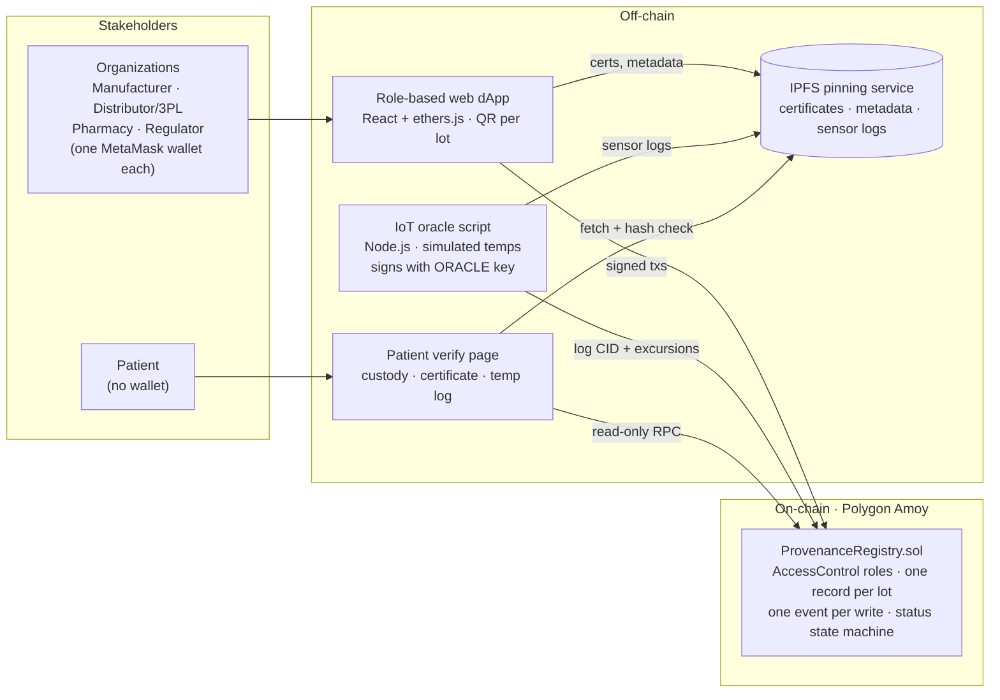
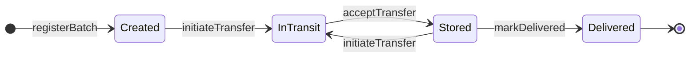

# Tamper-Evident Pharmaceutical Cold-Chain Provenance

[](https://github.com/Srijan2601/cse540-pharma-provenance/actions/workflows/ci.yml)

A shared, tamper-evident record of a prescription drug lot's **custody, temperature condition and certification**. Rival supply-chain companies can write to it, and **anyone, including a patient with no wallet, can verify it** by scanning a QR code.

**CSE 540: Engineering Blockchain Applications · Project Group 2 · Fall 2026**

Solidity 0.8 · Polygon Amoy testnet · Hardhat 3 · OpenZeppelin AccessControl · React + ethers.js · IPFS

> **Current milestone: Smart Contract Draft (11/01).**
>
> - The contract interface is complete: types, events, errors, and every function signature, with comments explaining each.
> - The draft contract compiles with **no warnings** and has roles, storage, read-only views and access control in place.
> - Each write function lists its logic as commented `TODO` steps (implementation is due with the 11/15 Amoy prototype).
> - `npm test` → **30 passing, 15 pending** (the pending ones are the state-machine tests still to write). Hardhat's last summary line counts the pending tests too and prints `45 passing (45 mocha)`.
>
> **Quick start:** `npm ci && npm test && npx hardhat run scripts/deploy.js` (no `.env` or wallet needed).
> To review the draft, see [`contracts/interfaces/IProvenanceRegistry.sol`](contracts/interfaces/IProvenanceRegistry.sol), [`contracts/ProvenanceRegistry.sol`](contracts/ProvenanceRegistry.sol) and [`contracts/README.md`](contracts/README.md).

## Contents

1. [The problem](#the-problem)
2. [How it works](#how-it-works)
3. [Contract components](#contract-components)
4. [Repository layout](#repository-layout)
5. [Setup](#setup)
6. [Usage: compile, test, deploy](#usage-compile-test-deploy)
7. [Configuration](#configuration)
8. [Deployments](#deployments)
9. [Roadmap and tasks](#roadmap-and-tasks)
10. [Contributing](#contributing)
11. [Team](#team)
12. [References and license](#references-and-license)

---

## The problem

A drug lot moves from a **manufacturer** through **distributors** to a **pharmacy**, and each one keeps its own records. Nobody, least of all the patient, can verify a lot's custody, temperature history or certification. So counterfeits enter at hand-offs, temperature excursions go hidden, and recalls stall. About 1 in 10 medical products in low- and middle-income countries is substandard or falsified [1]. The FDA keeps extending U.S. electronic drug-tracing deadlines because sharing data between many parties is hard [2].

**Why a blockchain:**
- Rival firms share one record that none of them controls.
- Signed, hash-linked transactions make the history tamper-evident.
- Anyone can audit it.
- A smart contract enforces one set of rules.

We use a **public** chain so patients can verify lots without joining a consortium (unlike permissioned Hyperledger Fabric, which we only compare against in our analysis).

## How it works



Fig. 1 links off-chain files on-chain by content hash (CID), so later edits are detectable. A CID is not a plain hash of the file's bytes, so the draft stores the CID **and** a keccak256 hash of those bytes (*proposed, O1*).

| # | Data flow | On-chain call(s) |
|---|---|---|
| 1 | **Register:** the manufacturer uploads lot metadata to IPFS (it references the certificate of analysis, *proposed C6*) and registers the lot | `registerBatch` |
| 2 | **Hand off:** each transfer is a signed initiate/accept pair naming the new custodian | `initiateTransfer` → `acceptTransfer` (`cancelTransfer` to undo, *proposed C3*) |
| 3 | **Monitor:** the oracle anchors sensor-log files; an excursion flags the lot **Compromised** | `anchorSensorLog`, `reportExcursion` |
| 4 | **Oversee:** the regulator onboards organizations and can certify or recall a lot at any stage | `grantRole` / `revokeRole`, `issueCertificate`, `recallBatch` |
| 5 | **Verify:** the patient scans the QR code; the page reads the lot and its event history over RPC and checks IPFS files against their on-chain hashes | `verifyBatch` + event logs |

### Actors and roles (proposal Table I)

| Actor | Contract role | Main functions | Journey stage |
|---|---|---|---|
| Manufacturer | `MANUFACTURER_ROLE` | `registerBatch`, `initiateTransfer` | Creation |
| Distributor / 3PL | `DISTRIBUTOR_ROLE` | `acceptTransfer`, `updateStatus`, `initiateTransfer` | Shipment, Storage |
| Pharmacy | `RETAILER_ROLE` | `verifyBatch`, `acceptTransfer`, `markDelivered` | Storage, Delivery |
| Regulator | `REGULATOR_ROLE` (admin) | `grantRole`, `issueCertificate`, `recallBatch` | All (audit) |
| IoT oracle | `ORACLE_ROLE` | `anchorSensorLog`, `reportExcursion` | Shipment, Storage |
| Patient | none (no wallet) | read-only `verifyBatch` via QR code | After delivery |

### Lot lifecycle



Not shown in the diagram:

* An active lot (**Created, InTransit or Stored**) becomes **Compromised** when the oracle reports an out-of-range reading.
* The regulator can **Recall** a lot in any status except Recalled (*proposed, C2, needs a vote*: Fig. 1 shows recall from active lots only, while data flow 4 says "at any stage").
* Delivered, Compromised and Recalled are terminal for custody.

The full transition table is in [`contracts/README.md`](contracts/README.md#function--transition--event-c1).

## Contract components

**[`contracts/interfaces/IProvenanceRegistry.sol`](contracts/interfaces/IProvenanceRegistry.sol)** is the cross-team API. The dApp, the oracle and the tests all code against it.

| Component | Contents |
|---|---|
| `enum Status` | `Created`, `InTransit`, `Stored`, `Delivered`, `Compromised`, `Recalled` |
| `struct DocumentRef` | `{ string cid; bytes32 contentHash; }`: an IPFS pointer plus keccak256 of the file's bytes (*proposed, O1*) |
| `struct Batch` | id, productHash, manufacturer, manufactureDate, registeredAt, custodian, pendingCustodian, status, min/max temperature (tenths of °C), sensorLogCount, metadata, certificate, latestSensorLog |
| Events (one per write) | `BatchRegistered`, `TransferInitiated`, `CustodyTransferred`, `StatusUpdated`, `CertificateIssued`, `SensorLogAnchored`, `ExcursionReported`, `BatchRecalled`, plus the proposed `TransferCancelled` |
| Custom errors | `BatchNotFound`, `NotCustodian`, `NotPendingCustodian`, `InvalidStatus`, `DuplicateProduct`, `ReadingWithinRange`, … |

```solidity
// Manufacturer
function registerBatch(bytes32 productHash, uint64 manufactureDate, int16 minTempTenthsC,
                       int16 maxTempTenthsC, DocumentRef calldata metadata) external returns (uint256 batchId);
// Custody hand-off
function initiateTransfer(uint256 batchId, address to) external;
function acceptTransfer(uint256 batchId) external;
function cancelTransfer(uint256 batchId) external;                       // proposed addition (C3)
function updateStatus(uint256 batchId, Status newStatus) external;       // InTransit <-> Stored
function markDelivered(uint256 batchId) external;
// Regulator (+ inherited grantRole / revokeRole)
function issueCertificate(uint256 batchId, DocumentRef calldata certificate) external;
function recallBatch(uint256 batchId, string calldata reason) external;
// IoT oracle
function anchorSensorLog(uint256 batchId, DocumentRef calldata sensorLog) external;
function reportExcursion(uint256 batchId, int16 readingTenthsC, uint64 observedAt,
                         DocumentRef calldata sensorLog) external;
// Read-only (anyone)
function verifyBatch(uint256 batchId) external view returns (Batch memory);
function totalBatches() external view returns (uint256);
function batchIdOf(bytes32 productHash) external view returns (uint256);
```

**[`contracts/ProvenanceRegistry.sol`](contracts/ProvenanceRegistry.sol)** is the draft implementation on OpenZeppelin `AccessControl`.

| Part | Draft status |
|---|---|
| Role constants and the constructor (the regulator is admin of the organization roles) | ✅ done |
| Storage layout (lot records, duplicate check, state saved for cancelling a hand-off) | ✅ done |
| Access control on every write (`onlyRole`, `onlyEitherRole`) | ✅ done, tested |
| Read-only views (`verifyBatch`, `totalBatches`, `batchIdOf`) | ✅ done, tested |
| Write-function bodies | 📝 numbered `TODO` steps, revert `NotImplemented()` (due 11/15) |

The proposal leaves some details open: which function causes each transition, how hand-offs work, field types, and how IPFS files are verified. The draft fills each gap with a **proposed** answer, tagged in code as `PROPOSED (C1)` etc. and listed in [`docs/design-decisions.md`](docs/design-decisions.md) for the team to confirm.

## Repository layout

```text
cse540-pharma-provenance/
├── contracts/
│   ├── interfaces/IProvenanceRegistry.sol   cross-team API: types, events, errors, signatures (NatSpec)
│   ├── ProvenanceRegistry.sol               draft implementation (AccessControl, storage, TODO bodies)
│   └── README.md                            roles, data model, transition table, events, how to implement
├── test/
│   └── ProvenanceRegistry.test.js           mocha + chai + ethers: 30 passing, 15 pending
├── scripts/
│   ├── deploy.js                            deploys and writes deployments/<network>.json
│   └── grant-roles.js                       regulator onboards the four organization roles
├── deployments/                             address + ABI + deployBlock per network (hand-off to frontend/oracle)
├── frontend/                                [planned] React + ethers.js role dashboards and patient verify page
├── oracle/                                  [planned] sensor simulator, oracle script, IPFS helpers
├── docs/
│   ├── README.md                            docs index and analysis plan
│   ├── design-decisions.md                  open design questions C1–C7, O1–O6, D1–D6
│   └── meetings/TEMPLATE.md                 Sunday sync notes template
├── .github/
│   ├── workflows/ci.yml                     compile + test on pushes to main and on every PR
│   └── pull_request_template.md             review + public-repo safety checklist
├── hardhat.config.js                        Solidity 0.8.34 (EVM: cancun); networks: in-process, localhost, amoy
├── package.json, package-lock.json          Hardhat 3, OpenZeppelin Contracts 5, mocha/chai/ethers
├── .env.example                             Amoy + role-setup variables (copy to .env)
└── .gitignore
```

`frontend/` and `oracle/` will each have their own `package.json`; the root project holds only the contracts. `frontend/` and `oracle/` each have a README with planned contents, config variables and a task checklist. `contracts/`, `deployments/` and `docs/` have reference READMEs.

## Setup

**Prerequisites**

| Tool | Version | Needed for |
|---|---|---|
| [Node.js](https://nodejs.org/) | **22.13 or newer** (tested with 22.18; Hardhat 3 exits on older 22.x) | everything |
| npm | 10+ (ships with Node 22) | everything |
| Git | any recent version | cloning |
| [MetaMask](https://metamask.io/) | latest | interacting with the dApp (later), Amoy deploys |
| Testnet POL | from the [Polygon faucet](https://faucet.polygon.technology/) | Amoy deploys only |

**Install**

```bash
git clone https://github.com/Srijan2601/cse540-pharma-provenance.git
cd cse540-pharma-provenance
npm ci                 # installs the exact versions from package-lock.json
```

The first compile downloads the Solidity compiler (0.8.34) automatically. You don't need a `.env` file to compile, test or use the local network.

**Dependencies** (from `package.json`)

| Package | Why |
|---|---|
| `hardhat` ^3.21 | compile, test, local chain, deploy scripts |
| `@nomicfoundation/hardhat-toolbox-mocha-ethers` ^4 | ethers v6 integration, chai matchers, network helpers, keystore, verify |
| `@openzeppelin/contracts` ^5.6 | audited `AccessControl` |
| `mocha`, `chai`, `ethers` | test runner, assertions, contract calls |
| `dotenv` | loads `.env` into `hardhat.config.js` |

## Usage: compile, test, deploy

| Command | What it does |
|---|---|
| `npx hardhat run scripts/deploy.js` | Deploy to a throwaway in-process chain: no node, no `.env`, nothing saved. The quickest check that deployment works. |
| `npm run compile` | Compile the contracts (should report no warnings). |
| `npm test` | Run the unit tests on an in-process chain. |
| `npm run test:gas` | Run the tests and print a per-function gas table. |
| `npm run node` | Start a local JSON-RPC chain at `http://127.0.0.1:8545` (chainId 31337) with 20 funded test accounts. |
| `npm run deploy:local` | Deploy to that local chain and write `deployments/localhost.json`. |
| `npm run roles:local` | Onboard demo organizations on the local chain. |
| `npm run deploy:amoy` | Deploy to Polygon Amoy and write `deployments/amoy.json`. |
| `npm run roles:amoy` | Onboard organizations on Amoy (addresses from `.env`). |
| `npm run clean` | Delete build outputs (`artifacts/`, `cache/`). |

### Local network (development and demo fallback)

The contingency plan says that if Amoy or IPFS is down, we demo on a local Hardhat network.

```bash
# terminal 1
npm run node

# terminal 2
npm run deploy:local     # regulator = account #0
npm run roles:local      # MANUFACTURER=#1, DISTRIBUTOR=#2, RETAILER=#3, ORACLE=#4 (Hardhat test accounts)
```

On the local network, the scripts always use these test accounts and ignore any Amoy addresses in `.env`, so the fallback demo works even after `.env` is filled in.

<details>
<summary>Connect MetaMask to the local chain</summary>

1. Add a network: RPC URL `http://127.0.0.1:8545`, chain ID `31337`, currency `ETH`.
2. Import accounts #0–#4 using the private keys printed by `npm run node`.
3. These keys are **publicly known**. Never send real funds to them or use them on a real network.
4. After restarting `npm run node`, clear MetaMask's activity for these accounts (*Settings → Advanced → Clear activity tab data*) so nonces reset.

</details>

### Polygon Amoy testnet

1. Create a **testnet-only** MetaMask wallet for deploying, and get POL from the [faucet](https://faucet.polygon.technology/).
2. `cp .env.example .env` and set `AMOY_RPC_URL`. Set the deployer key in **one** of two ways:
   - **Recommended:** Hardhat's encrypted keystore, so the key is never stored in plain text:
     ```bash
     npx hardhat keystore set DEPLOYER_PRIVATE_KEY
     ```
     Leave `DEPLOYER_PRIVATE_KEY` commented out in `.env` and unset in your shell. Any value there, even an empty one, overrides the keystore.
   - Or uncomment `DEPLOYER_PRIVATE_KEY` in `.env` and set it there (`.env` is gitignored).
3. Deploy, then onboard organizations. Set `MANUFACTURER_ADDRESS` etc. in `.env` first. `roles:amoy` sends from the `DEPLOYER_PRIVATE_KEY` account, which must hold REGULATOR_ROLE, so either leave `REGULATOR_ADDRESS` empty or run `roles:amoy` with the regulator's key.
   ```bash
   npm run deploy:amoy      # prints https://amoy.polygonscan.com/address/<address>
   npm run roles:amoy
   ```
4. Commit `deployments/amoy.json` and update the [Deployments](#deployments) table.

Amoy network details: chain ID `80002` · currency `POL` · RPC `https://rpc-amoy.polygon.technology` · explorer [amoy.polygonscan.com](https://amoy.polygonscan.com).

> **Draft limitation:** until the write functions are implemented (11/15), a deployed registry can onboard organizations and answer read-only calls. `registerBatch` and the other writes revert with `NotImplemented()`.

## Configuration

Copy [`.env.example`](.env.example) to `.env`. It is only needed for Amoy. On the local network, the scripts ignore the address variables below.

| Variable | Secret? | Used by | Purpose |
|---|---|---|---|
| `AMOY_RPC_URL` | if it contains an API key | `hardhat.config.js` | Amoy JSON-RPC endpoint |
| `DEPLOYER_PRIVATE_KEY` | **yes** (prefer the keystore) | `hardhat.config.js` | testnet deployer wallet |
| `REGULATOR_ADDRESS` | no | `scripts/deploy.js` | gets REGULATOR + admin role (default: deployer). If set, `roles:amoy` needs that wallet's key. |
| `MANUFACTURER_ADDRESS`, `DISTRIBUTOR_ADDRESS`, `RETAILER_ADDRESS`, `ORACLE_ADDRESS` | no | `scripts/grant-roles.js` | organization wallets to onboard |
| `REGISTRY_ADDRESS` | no | `scripts/grant-roles.js` | overrides `deployments/<network>.json` |

`frontend/` and `oracle/` will have their own `.env.example` files. Their planned variables are listed in their READMEs.

## Deployments

| Network | Address | Deploy block | Date |
|---|---|---|---|
| Polygon Amoy (80002) | *not deployed yet (target 11/08–11/10)* | – | – |

Machine-readable records (address, deploy block, ABI) are in [`deployments/`](deployments/).

## Roadmap and tasks

Milestones are from the proposal §6 and Team Contract §5. The internal freeze, integration and submit dates are **proposed** in [D3](docs/design-decisions.md#delivery-and-process-d).
Day-to-day tasks live on the GitHub Projects board. This list is the overview.

### ✅ 11/01: Smart Contract Draft
- [x] Repository structure and tooling (Hardhat 3, OpenZeppelin 5, CI, PR template)
- [x] `IProvenanceRegistry`: enum, structs, the 8 events from Fig. 1 (+1 proposed), errors, every Table I signature with NatSpec
- [x] `ProvenanceRegistry` draft: roles, storage, constructor, views, access control; write bodies as TODO steps
- [x] Unit tests: deployment, role administration, interface completeness, access control (30 passing, 15 pending)
- [x] Deploy and role-setup scripts, tested on a local node
- [x] Proposal gap review recorded in `docs/design-decisions.md`
- [ ] Team review of the proposed decisions **C1–C7** at the next Sunday sync
- [ ] Tag the submitted commit `v0.1-contract-draft`

### 11/15: Midterm progress update (Amoy prototype + 5-minute video)
*Proposed internal dates: freeze 11/11 · integration session 11/12 · submit 11/13*
- **Contract:**
  - [ ] Implement all write functions and turn the pending tests into real tests, including revert cases. The full-journey test moves to `test/integration/` for 11/25 (D4).
  - [ ] First Amoy deploy, `deployments/amoy.json` committed, source verified on Polygonscan.
  - [ ] `scripts/seed-demo.js` to create demo lots for the video.
- **Off-chain:**
  - [ ] Decide O1 (hash rule), O2 (schemas) and O3 (upload path).
  - [ ] Upload helper.
  - [ ] Sensor simulator with normal and excursion scenarios.
  - [ ] Oracle anchoring logs on Amoy.
- **Frontend:**
  - [ ] Wallet connect and role detection.
  - [ ] Register and hand-off flows.
  - [ ] QR code per lot.
  - [ ] Verify page showing custody history.
- **QA / docs:**
  - [ ] Branch ruleset and Projects board (D2).
  - [ ] Test plan in `docs/testing/` (D4).
  - [ ] Demo runbook.
  - [ ] Midterm video.

### 11/25: Features complete
- [ ] Data flows 1–5 working end to end on Amoy, including the excursion and recall paths
- [ ] Regulator dashboard (onboard, certify, recall)
- [ ] Verify page checks IPFS files against on-chain hashes, and flags Compromised, Recalled and uncertified lots
- [ ] Encrypt confidential documents before upload (proposal §5; which documents, in O5)
- [ ] Integration journey test in `test/integration/`
- [ ] Local fallback rehearsed (Hardhat node + local IPFS with the same CIDs)
- [ ] Gas data frozen for the analysis

### 12/04: Final submission (demo video, repository, IEEE report)
*Proposed internal dates: integration 12/01 · submit 12/02*
- [ ] Analysis: gas cost, scalability, privacy, regulation, centralized comparison, trusted keys (`docs/analysis/`)
- [ ] IEEE-format report and demo video
- [ ] Verify page hosted publicly; README deployments table final; tag `v1.0-final`

### Stretch goals (dropped first if work slips)
- [ ] Package-level serial numbers
- [ ] ERC-721 lot tokens. Decide **before** the `Batch` struct is final, because it changes IDs and storage.
- [ ] *(proposed addition, C2; not in the proposal)* A regulator `clearExcursion` for false alarms

**Out of scope:** real IoT sensors; personal or patient data of any kind.

## Contributing

1. **Pick a task** on the GitHub Projects board and assign yourself.
2. **Branch** from `main`, e.g. `feat/contract-register-batch`, `feat/frontend-verify-page`, `docs/analysis-gas`.
3. **Test:** run `npm test` before pushing. CI runs `compile` and `test` on every PR.
4. **Open a PR** using the template. **Every PR is reviewed by a teammate** before merging, and `main` must always pass CI (Team Contract §2).
5. **Changing the interface** (`IProvenanceRegistry.sol`) changes the ABI the frontend and oracle use. Say so in the PR, update `contracts/README.md`, and redeploy.
6. **Settling a design question?** Update [`docs/design-decisions.md`](docs/design-decisions.md) in the same PR.

**This repository is public.** Never commit:
- private keys, seed phrases, `.env` files or API tokens;
- ASU IDs or email addresses;
- the proposal / team-contract PDF (it contains student IDs).

Use testnet-only wallets. Keep attendance and other team-internal notes in the team's private log, not in `docs/meetings/`.

## Team

| Member | Role (Team Contract §1) | GitHub |
|---|---|---|
| Shaurya | Project Lead, QA & Docs | [shaurya-asu](https://github.com/shaurya-asu) |
| Abedh Tiwari | Smart Contract Lead | *TBD* |
| Srijan Girdhar | Front-End / dApp Lead | [Srijan2601](https://github.com/Srijan2601) |
| Soham Kumar | Off-Chain & IoT Lead | [snola534-alt](https://github.com/snola534-alt) |

Roles are leads, not exclusive owners: everyone codes, writes and presents (Team Contract §2). Weekly sync: Sundays 7–8 PM AZ.

## References and license

1. World Health Organization, "1 in 10 medical products in developing countries is substandard or falsified," 2017.
2. U.S. Food and Drug Administration, "Exemptions under the Drug Supply Chain Security Act," fda.gov, 2026.
3. R. Kamath, "Food traceability on blockchain: Walmart's pork and mango pilots with IBM," *J. Brit. Blockchain Assoc.*, 2018.
4. T. Bocek et al., "Blockchains everywhere: A use-case of blockchains in the pharma supply-chain," *IFIP/IEEE IM*, 2017.
5. A. Musamih et al., "A blockchain-based approach for drug traceability in healthcare supply chain," *IEEE Access*, 2021.

**License:** not chosen yet (team decision). Until then, all rights are reserved, and the Solidity sources carry `SPDX-License-Identifier: UNLICENSED`. OpenZeppelin Contracts is MIT-licensed.

Course project for CSE 540 at Arizona State University. Testnet only: not for production or medical use.
