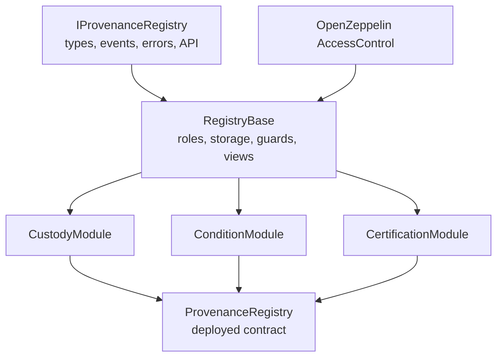
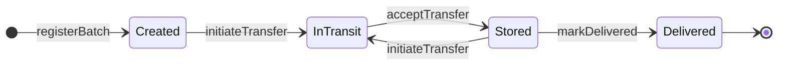

# Smart contracts

The on-chain half of the system: one `ProvenanceRegistry` contract that keeps a single, tamper-evident record per drug lot. Supply-chain organizations write to it, each limited to its own functions. Anyone can read it, so a patient needs no wallet to verify a lot. The demo runs it on a local Hardhat chain, and it is deployed on the Polygon Amoy testnet at `0x603E9669D24BFf7c073ECcea36d203A453d49664` (see the [root README](../README.md#polygon-amoy)).

Solidity 0.8.x, OpenZeppelin `AccessControl` (v5), Hardhat 3. IDs like **C3** or **O1** below name the design decisions recorded in [`../docs/design-decisions.md`](../docs/design-decisions.md).

## Files

| File | Responsibility |
|---|---|
| [`interfaces/IProvenanceRegistry.sol`](interfaces/IProvenanceRegistry.sol) | The cross-team API: `Status` enum, `DocumentRef` / `Batch` structs, events, custom errors, and every external function with its NatSpec. The dApp, the oracle and the tests code against this file. |
| [`base/RegistryBase.sol`](base/RegistryBase.sol) | Shared foundation (abstract): role constants, the constructor that wires the role hierarchy, storage and its invariants, the guards every module reuses, the read-only views, `supportsInterface`. |
| [`modules/CustodyModule.sol`](modules/CustodyModule.sol) | Custody (abstract): `registerBatch`, `initiateTransfer`, `acceptTransfer`, `cancelTransfer`, `updateStatus`, `markDelivered`. |
| [`modules/ConditionModule.sol`](modules/ConditionModule.sol) | Condition (abstract): `anchorSensorLog`, `reportExcursion`. |
| [`modules/CertificationModule.sol`](modules/CertificationModule.sol) | Certification (abstract): `issueCertificate`, `recallBatch`. |
| [`ProvenanceRegistry.sol`](ProvenanceRegistry.sol) | The one deployed contract. It composes the three modules and adds no logic of its own. |



The modules mirror the proposal's split of a lot's record into custody, condition and certification. They are separate source files, not separate contracts on chain: the proposal promises a single registry, and one deployment keeps everything about a lot in one record that a single `verifyBatch` call returns. All three modules inherit the same `RegistryBase`, so they work on the same storage. That is what lets an excursion report or a recall close a hand-off that the custody module opened.

Deployment is unchanged by the split: [`../scripts/deploy.js`](../scripts/deploy.js) deploys `ProvenanceRegistry` with one constructor argument, the regulator's address.

## Roles

Each organization holds one role (proposal Table I). The regulator's wallet also holds `DEFAULT_ADMIN_ROLE`.

| Role constant | Held by | Can call | Admin of the role |
|---|---|---|---|
| `REGULATOR_ROLE` (+ `DEFAULT_ADMIN_ROLE`) | Regulator, set in the constructor | `grantRole`, `revokeRole`, `issueCertificate`, `recallBatch` | `DEFAULT_ADMIN_ROLE` |
| `MANUFACTURER_ROLE` | Drug manufacturer | `registerBatch`, `initiateTransfer`, `cancelTransfer` | `REGULATOR_ROLE` |
| `DISTRIBUTOR_ROLE` | Distributor / 3PL | `acceptTransfer`, `initiateTransfer`, `cancelTransfer`, `updateStatus` | `REGULATOR_ROLE` |
| `RETAILER_ROLE` | Pharmacy | `acceptTransfer`, `markDelivered` | `REGULATOR_ROLE` |
| `ORACLE_ROLE` | IoT oracle script | `anchorSensorLog`, `reportExcursion` | `REGULATOR_ROLE` |
| none | Anyone, e.g. a patient with no wallet | `verifyBatch`, `totalBatches`, `batchIdOf` | n/a |

* The **regulator onboards organizations** (data flow 4) with the inherited `grantRole(role, account)` and offboards them with `revokeRole`. Each emits OpenZeppelin's `RoleGranted` / `RoleRevoked`. An organization can give up its own role with the inherited `renounceRole(role, ownAddress)`.
* The deployer gets **no role** unless it is also the regulator (`scripts/deploy.js` uses the deployer when `REGULATOR_ADDRESS` is empty).
* **A role is not enough for custody actions (C4).** A role says what kind of organization the caller is, not which lots are theirs. The caller must also be the lot's current **custodian**, or the **pending custodian** for `acceptTransfer`. Otherwise any distributor could move every other distributor's lots.
* **The role check always runs first**, whatever lot or argument values the call names. A single-role function reverts with OpenZeppelin's `AccessControlUnauthorizedAccount(account, role)`; a two-role function reverts with `MissingEitherRole(account, roleA, roleB)`. Only calldata that the ABI decoder rejects fails earlier (see the note under [Errors](#errors)).
* `cancelTransfer` is not in proposal Table I. It was added (**C3**) so that a hand-off the recipient never accepts cannot leave a lot stuck in transit.

## Data model

```solidity
struct DocumentRef { string cid; bytes32 contentHash; }   // IPFS CID + keccak256(file bytes)  (O1)

struct Batch {
    uint256 id;                  // 1, 2, 3, ... (0 = no such lot)
    bytes32 productHash;         // keccak256(abi.encode(productCode, lotNumber)); unique  (C5)
    address manufacturer;        // origin
    uint64  manufactureDate;     // Unix seconds
    uint64  registeredAt;        // block timestamp
    address custodian;           // current holder
    address pendingCustodian;    // open hand-off recipient, or 0x0
    Status  status;
    int16   minTempTenthsC;      // e.g. 20 = 2.0 °C   (C7)
    int16   maxTempTenthsC;      // e.g. 80 = 8.0 °C
    uint32  sensorLogCount;      // shares a storage slot with the four fields above
    DocumentRef metadata;        // lot metadata JSON on IPFS
    DocumentRef certificate;     // latest regulator certificate (empty = uncertified)  (C6)
    DocumentRef latestSensorLog; // latest anchored sensor log
}
```

* **CID plus hash (O1).** A CID depends on how IPFS chunked the file, so it is not a plain hash of the bytes. The registry stores the CID to find the file and `keccak256` of the exact bytes to check it. A reference with an empty CID or a zero hash is rejected (`EmptyDocument`).
* **Only the latest certificate and sensor log are stored (C6, C7).** Earlier ones stay in events, so the storage and the cost of `verifyBatch` do not grow with the length of the journey.
* **Lots, not packages, and no personal data.** The record holds hashes, addresses of organizations, temperatures and document pointers.

## Lot lifecycle



Not drawn, to keep the diagram readable:

* `cancelTransfer` returns a lot with an open hand-off to the status it had before (`Created` or `Stored`).
* `updateStatus` lets a distributor custodian switch `InTransit` ⇄ `Stored` when no hand-off is open.
* `reportExcursion` sends any **active** lot (`Created`, `InTransit` or `Stored`) to `Compromised`.
* `recallBatch` sends a lot in **any status except `Recalled`** to `Recalled`.

`Delivered`, `Compromised` and `Recalled` are terminal for custody (**C2**). `Recalled` is final: no function changes a recalled lot.

### Function → transition → event (C1)

Every function checks the caller's role first, once its arguments have been decoded. The last column lists the reverts that can follow. Where they are joined by `→` the order is part of the API; where they are joined by commas no order is promised.

| Function | Caller (role; condition) | Status before → after | Event | Reverts after the role check |
|---|---|---|---|---|
| `registerBatch(productHash, manufactureDate, minTempTenthsC, maxTempTenthsC, metadata)` | MANUFACTURER | none → `Created` | `BatchRegistered` | `ZeroProductHash`, `InvalidTimestamp`, `InvalidTemperatureRange`, `EmptyDocument`, `DuplicateProduct` |
| `initiateTransfer(batchId, to)` | MANUFACTURER or DISTRIBUTOR; custodian | `Created`/`Stored` → `InTransit` | `TransferInitiated` | `BatchNotFound` → `NotCustodian` → `TransferAlreadyPending` → `InvalidStatus` → `InvalidRecipient` |
| `acceptTransfer(batchId)` | DISTRIBUTOR or RETAILER; pending custodian | `InTransit` → `Stored` (custody moves) | `CustodyTransferred` | `BatchNotFound` → `NoPendingTransfer` → `NotPendingCustodian` |
| `cancelTransfer(batchId)` | MANUFACTURER or DISTRIBUTOR; custodian | `InTransit` → status before the hand-off | `TransferCancelled` | `BatchNotFound` → `NotCustodian` → `NoPendingTransfer` |
| `updateStatus(batchId, newStatus)` | DISTRIBUTOR; custodian | `InTransit` ⇄ `Stored` | `StatusUpdated` | `BatchNotFound` → `NotCustodian` → `TransferAlreadyPending` → `InvalidStatusTransition` |
| `markDelivered(batchId)` | RETAILER; custodian | `Stored` → `Delivered` | `StatusUpdated` | `BatchNotFound`, `NotCustodian`, `InvalidStatus` |
| `issueCertificate(batchId, certificate)` | REGULATOR | unchanged (any status except `Recalled`) | `CertificateIssued` | `BatchNotFound`, `InvalidStatus`, `EmptyDocument` |
| `recallBatch(batchId, reason)` | REGULATOR | any except `Recalled` → `Recalled` | `BatchRecalled` | `BatchNotFound`, `InvalidStatus`, `EmptyReason` |
| `anchorSensorLog(batchId, sensorLog)` | ORACLE | unchanged (active lots only) | `SensorLogAnchored` | `BatchNotFound`, `InvalidStatus`, `EmptyDocument` |
| `reportExcursion(batchId, readingTenthsC, observedAt, sensorLog)` | ORACLE | active → `Compromised` | `ExcursionReported` | `BatchNotFound`, `InvalidStatus`, `InvalidTimestamp`, `ReadingWithinRange`, `EmptyDocument` |
| `verifyBatch(batchId)` → `Batch` | anyone (view) | n/a | n/a | `BatchNotFound` |
| `totalBatches()` / `batchIdOf(productHash)` | anyone (view) | n/a | n/a | none |

Hand-off routes (**C3**): the recipient of `initiateTransfer` must hold `DISTRIBUTOR_ROLE`, or hold `RETAILER_ROLE` when the caller holds `DISTRIBUTOR_ROLE`. A caller that holds `MANUFACTURER_ROLE` but not `DISTRIBUTOR_ROLE` cannot hand off directly to a pharmacy. Routes are checked on roles, not organizations, so a manufacturer that the regulator has also made a distributor can ship to a pharmacy. Custody moves only when the recipient calls `acceptTransfer`, so every hand-off carries two signatures.

Entering `Compromised` or `Recalled` clears any open hand-off. If it stayed open, the named recipient could still accept it, which would move a flagged lot to a new custodian and overwrite its status.

### Errors

Every failure is a custom error that carries the values needed to explain it.

| Error | Raised when |
|---|---|
| `AccessControlUnauthorizedAccount(account, role)` | The caller lacks the single role a function requires (OpenZeppelin). |
| `AccessControlBadConfirmation()` | `renounceRole(role, account)` called with an `account` other than the caller (OpenZeppelin). |
| `MissingEitherRole(account, roleA, roleB)` | The caller holds neither of the two roles a function accepts. |
| `ZeroAddress()` | The constructor was given a zero regulator. |
| `BatchNotFound(batchId)` | The ID is 0 or greater than `totalBatches()`. |
| `ZeroProductHash()` | `registerBatch` with a zero product hash. |
| `DuplicateProduct(productHash, existingBatchId)` | `registerBatch` with a product hash that is already registered. |
| `InvalidTimestamp(timestamp)` | `manufactureDate` or `observedAt` is 0 or later than the block timestamp. |
| `InvalidTemperatureRange(min, max)` | `registerBatch` with `min >= max`. |
| `EmptyDocument()` | A `DocumentRef` has an empty CID or a zero content hash. |
| `NotCustodian(batchId, caller)` | The caller has the role but does not hold this lot. |
| `NotPendingCustodian(batchId, caller)` | `acceptTransfer` by someone other than the named recipient. |
| `TransferAlreadyPending(batchId, pendingCustodian)` | `initiateTransfer` or `updateStatus` while a hand-off is open. |
| `NoPendingTransfer(batchId)` | `acceptTransfer` or `cancelTransfer` with no open hand-off. |
| `InvalidRecipient(to)` | `initiateTransfer` to the zero address, to the caller itself, or along a route that is not allowed. |
| `InvalidStatus(batchId, current)` | The action is not allowed in the lot's current status. |
| `InvalidStatusTransition(batchId, from, to)` | `updateStatus` with any pair other than `InTransit` → `Stored` or `Stored` → `InTransit`. |
| `ReadingWithinRange(reading, min, max)` | `reportExcursion` with `min <= reading <= max`. |
| `EmptyReason()` | `recallBatch` with an empty reason. |

Calldata that Solidity's ABI decoder rejects reverts before any of these checks, including the role check, with empty revert data. The case an ethers client can send is a `newStatus` outside the `Status` enum (ethers encodes the enum as a plain `uint8`). Hand-made calldata can also carry a word that is not a valid encoding of its parameter type, such as an out-of-range `int16` or an address with non-zero upper bits.

### Events

Each successful write emits exactly one registry event. Every event indexes `batchId`, so the verify page can rebuild a lot's whole history with a `batchId`-filtered `eth_getLogs` from `deployBlock` (in `deployments/<network>.json`). On public RPCs, query it in block-range pages (**O6**). `ExcursionReported` carries the excursion log's index and hash, because that log is not also emitted as `SensorLogAnchored`.

`BatchRegistered` · `TransferInitiated` · `CustodyTransferred` · `TransferCancelled` · `StatusUpdated` · `CertificateIssued` · `SensorLogAnchored` · `ExcursionReported` · `BatchRecalled`, plus OpenZeppelin's `RoleGranted` / `RoleRevoked` / `RoleAdminChanged` for role changes.

## Invariants

These hold before and after every transaction. They are stated, with the reason each one holds, in the contract NatSpec of `base/RegistryBase.sol`, which declares the storage. The tests check them after every call of the state-machine matrix and of both random walks (`expectInvariants` in `test/helpers/registry.js`, `RandomWalk.t.sol`).

| ID | Invariant |
|---|---|
| **I1** | `pendingCustodian != address(0)` implies `status == InTransit`. |
| **I2** | `status` in {`Delivered`, `Compromised`, `Recalled`} implies `pendingCustodian == address(0)`. |
| **I3** | Lot IDs are exactly `1..totalBatches()`; `batchIdOf(productHash)` returns the lot registered with that hash, or 0. |
| **I4** | Every existing lot has a non-zero `custodian` and `manufacturer`. |
| **I5** | `Recalled` is absorbing; from `Delivered` or `Compromised` the only possible change of status is to `Recalled`. |

Where a check could only fail if an invariant were broken, the code relies on the invariant instead of repeating the check. For example, `acceptTransfer` does not test the status, because an open hand-off already implies `InTransit` (I1).

## Trust assumptions

* **Regulator key**: the root of trust (proposal §2). It is the admin of every organization role, can recall any lot, and through `DEFAULT_ADMIN_ROLE` can appoint further regulators. It can grant any role to any account, including itself. Granting a second role widens what an account may do: a manufacturer that is also a distributor can ship its own lots straight to a pharmacy. A recall cannot be undone, and a lost key cannot be recovered.
* **Oracle key**: the contract checks that a *reported* excursion reading is outside the lot's range, but it cannot check that the reading is true. A faulty or stolen oracle key can mark any active lot `Compromised`, and no function reverses that. Each report is tied to a sensor-log file whose hash is on-chain, so it can be audited afterwards.
* **Manufacturers**: product + lot uniqueness is global (**C5**), so a manufacturer could register another firm's product code and lot number first. Recalling that lot does not free the hash. The regulator decides who holds `MANUFACTURER_ROLE`.
* **Offboarding**: revoking the role of a lot's custodian freezes that lot where it is. The oracle can still monitor it and the regulator can still certify or recall it, but no function moves custody away from an offboarded organization. The one exception is a hand-off that the organization opened before the revocation: its named recipient can still accept it, because `acceptTransfer` checks only the recipient's role.
* **Role administration**: OpenZeppelin's single-step `AccessControl`, not `AccessControlDefaultAdminRules`. A regulator that renounces `DEFAULT_ADMIN_ROLE` without first granting it to another account leaves nobody able to appoint regulators, and nothing restores that.
* **Timestamps**: `manufactureDate` and `observedAt` are supplied by the caller. The contract only rejects 0 and values in the future; `registeredAt` and the block of each event are the times the chain itself vouches for.
* **Gateways and pinning**: off-chain files cannot be changed without detection, because their `keccak256` is on-chain (**O1**). They can still become unavailable if they are unpinned.

## Compile and test

```bash
npm run compile            # hardhat compile, then export the ABI to deployments/abi/ (must stay warning-free)
npm test                   # every suite: the Solidity tests, then the Mocha tests
npm run test:unit          # only test/unit        (likewise test:integration, test:tooling)
npm run test:solidity      # only test/solidity
npm run coverage           # line and statement coverage of contracts/ (report in coverage/)
npm run test:gas           # gas table of the Mocha tests' transactions (raw JSON: npm run test:gas -- --gas-stats-json <file>)
npm run gas:report         # the reference cost tables: per transaction and per lot, in docs/analysis/data/gas-report.{json,md}
npm run demo               # two lots on an in-process chain: A goes manufacturer -> distributor -> pharmacy,
                           # B has a temperature excursion and is recalled
```

`npm run test:gas` measures whatever the Mocha tests happen to send, so its numbers vary with the tests. The deterministic numbers for the analysis come from `npm run gas:report`.

Tests live in [`../test/`](../test/), grouped by what they exercise:

| Directory | Contents |
|---|---|
| `test/helpers/` | Shared Mocha code. `registry.js`: constants that mirror the API (statuses, roles, the roles each function accepts), synthetic documents and product hashes, fixtures that put a lot into each of nine states through real calls, and the assertions `expectRejected` (exact custom error, record unchanged), `expectOnlyEvent` (exactly one registry event) and `expectInvariants` (I1-I5 plus properties derived from the custody rules). `common.js`: the seeded PRNG and the custom-error decoder that the unit and integration tests share. |
| `test/unit/` | Mocha tests of one function or rule at a time, one file per area (deployment, registration, custody, condition, certification): the successful call with its event and record, and every revert listed above. `AccessControl.test.js` is a role × function matrix; `StateMachine.test.js` is a lot state × function matrix plus a seeded random walk. |
| `test/integration/` | Mocha tests of whole journeys across several roles: data flows 1-5 end to end, the journeys off the happy path (excursion, recall, cancel, offboarding), and the event log replayed into every lot's record. |
| `test/solidity/` | Fuzz and invariant properties written in Solidity and run by Hardhat's Solidity test runner, including a stateful random walk that checks I1-I5 after every step. |
| `test/tooling/` | Checks of the project tooling: the committed ABI matches the compiled contract (`abi-sync`), the committed gas report was measured on the current code (`gas-report-sync`), and the CID helper gives the CIDs IPFS gives (`cid`). |

The tests run locally inside Hardhat. They need no `.env` and no running node.

Any change to the external interface (functions, events or errors, in `IProvenanceRegistry.sol` or in the contracts that implement it) changes the ABI that `frontend/` and `oracle/` load. Run `npm run compile` and commit `deployments/abi/ProvenanceRegistry.json` in the same PR; `test/tooling/abi-sync.test.js` fails otherwise. A network that already has a `deployments/<network>.json` keeps the old ABI until it is redeployed. Tell the team in the PR. Any change to the code also changes the gas numbers: run `npm run gas:report` and commit `docs/analysis/data/`, or `test/tooling/gas-report-sync.test.js` fails. See [`../deployments/README.md`](../deployments/README.md).

The registry on Polygon Amoy (`deployments/amoy.json`) was compiled from these sources: its runtime code on chain equals a build of `main`, metadata hash included. That hash covers every source file byte for byte, so any edit to a `.sol` file, even to a comment, breaks the match; source verification would then have to run from the deployed commit (see [`../deployments/README.md`](../deployments/README.md#verifying-the-source-on-the-amoy-explorer)).
