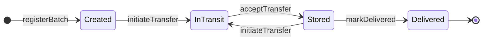

# Smart contracts

The on-chain half of the system: one `ProvenanceRegistry` contract on Polygon Amoy that keeps a single, tamper-evident record per drug lot.

| File | What it is | Draft status (11/01) |
|---|---|---|
| [`interfaces/IProvenanceRegistry.sol`](interfaces/IProvenanceRegistry.sol) | Cross-team API: `Status` enum, `DocumentRef` / `Batch` structs, events, custom errors, every function signature with NatSpec comments. | Complete for the draft |
| [`ProvenanceRegistry.sol`](ProvenanceRegistry.sol) | Implementation, built on OpenZeppelin `AccessControl` (v5). | Roles, storage, constructor, views and access checks are done. Write-function bodies are `TODO` step lists that revert with `NotImplemented()`. |

Tests: [`../test/ProvenanceRegistry.test.js`](../test/ProvenanceRegistry.test.js). Deploy: [`../scripts/deploy.js`](../scripts/deploy.js). Design gaps and the draft's answers to them: [`../docs/design-decisions.md`](../docs/design-decisions.md) (IDs like **C1** below point there).

---

## Roles

Each organization uses one wallet (proposal Fig. 1) with one organization role (Table I). The regulator's wallet also holds `DEFAULT_ADMIN_ROLE`. `cancelTransfer` is a *proposed* addition (**C3**).

| Role constant | Held by | Can call | Admin of the role |
|---|---|---|---|
| `REGULATOR_ROLE` (+ `DEFAULT_ADMIN_ROLE`) | Regulator, set in the constructor | `grantRole`, `revokeRole`, `issueCertificate`, `recallBatch` | `DEFAULT_ADMIN_ROLE` |
| `MANUFACTURER_ROLE` | Drug manufacturer | `registerBatch`, `initiateTransfer`, `cancelTransfer` | `REGULATOR_ROLE` |
| `DISTRIBUTOR_ROLE` | Distributor / 3PL | `acceptTransfer`, `initiateTransfer`, `cancelTransfer`, `updateStatus` | `REGULATOR_ROLE` |
| `RETAILER_ROLE` | Pharmacy | `acceptTransfer`, `markDelivered` | `REGULATOR_ROLE` |
| `ORACLE_ROLE` | IoT oracle script | `anchorSensorLog`, `reportExcursion` | `REGULATOR_ROLE` |
| none | Anyone, e.g. a patient with no wallet | `verifyBatch`, `totalBatches`, `batchIdOf` | n/a |

* The **regulator onboards organizations** (data-flow step 4) with the inherited `grantRole(role, account)` and offboards them with `revokeRole`. Each emits OpenZeppelin's `RoleGranted` / `RoleRevoked`.
* The deployer gets **no role** unless it is also the regulator (`scripts/deploy.js` uses the deployer when `REGULATOR_ADDRESS` is empty).
* Having the role is not enough for custody actions: the caller must also be the lot's current **custodian**, or the **pending custodian** for `acceptTransfer`. Otherwise any distributor could move any other distributor's lots (**C4**).

## Data model

```solidity
struct DocumentRef { string cid; bytes32 contentHash; }   // IPFS CID + keccak256(file bytes)  (O1)

struct Batch {
    uint256 id;                  // 1, 2, 3, ... (0 = no such lot)
    bytes32 productHash;         // keccak256(abi.encode(productCode, lotNumber)); unique  (C5)
    address manufacturer;        // origin
    uint64  manufactureDate;     // Unix seconds
    uint64  registeredAt;        // block timestamp
    address custodian;           // current holder
    address pendingCustodian;    // open hand-off recipient, or 0x0
    Status  status;
    int16   minTempTenthsC;      // e.g. 20 = 2.0 °C   (C7)
    int16   maxTempTenthsC;      // e.g. 80 = 8.0 °C
    uint32  sensorLogCount;      // packed into the same storage slot as the fields above
    DocumentRef metadata;        // lot metadata JSON on IPFS
    DocumentRef certificate;     // latest regulator certificate (empty = uncertified)  (C6)
    DocumentRef latestSensorLog; // latest anchored sensor log
}
```

Only the **latest** certificate and sensor log are stored. Earlier ones stay in events, so storage and gas per lot stay flat however long the journey is. No personal data is stored on-chain.

## Lot lifecycle



Not shown in the diagram, to keep it readable:

* `updateStatus` lets a distributor custodian switch InTransit ⇄ Stored when no hand-off is open.
* `cancelTransfer` returns an open hand-off to the status it had before.
* `reportExcursion` sends any **active** lot (Created, InTransit or Stored) to **Compromised**.
* `recallBatch` sends a lot in **any status except Recalled** to **Recalled**.

**Delivered, Compromised and Recalled are terminal for custody (C2).**

### Function → transition → event (C1)

| Function | Caller (role + condition) | Status before → after | Event | Main reverts |
|---|---|---|---|---|
| `registerBatch(productHash, manufactureDate, minTempTenthsC, maxTempTenthsC, metadata)` | MANUFACTURER | none → `Created` | `BatchRegistered` | `DuplicateProduct`, `InvalidTemperatureRange`, `EmptyDocument` |
| `initiateTransfer(batchId, to)` | MANUFACTURER or DISTRIBUTOR, custodian | `Created`/`Stored` → `InTransit` | `TransferInitiated` | `NotCustodian`, `TransferAlreadyPending`, `InvalidRecipient`, `InvalidStatus` |
| `acceptTransfer(batchId)` | DISTRIBUTOR or RETAILER, pending custodian | `InTransit` → `Stored` (custodian changes) | `CustodyTransferred` | `NotPendingCustodian`, `NoPendingTransfer` |
| `cancelTransfer(batchId)` *(proposed, C3)* | MANUFACTURER or DISTRIBUTOR, custodian | `InTransit` → status before the transfer | `TransferCancelled` | `NotCustodian`, `NoPendingTransfer` |
| `updateStatus(batchId, newStatus)` | DISTRIBUTOR, custodian, no open hand-off | `InTransit` ⇄ `Stored` | `StatusUpdated` | `NotCustodian`, `TransferAlreadyPending`, `InvalidStatus` |
| `markDelivered(batchId)` | RETAILER, custodian | `Stored` → `Delivered` | `StatusUpdated` | `NotCustodian`, `InvalidStatus` |
| `issueCertificate(batchId, certificate)` | REGULATOR | unchanged (any status except `Recalled`) | `CertificateIssued` | `BatchNotFound`, `InvalidStatus`, `EmptyDocument` |
| `recallBatch(batchId, reason)` | REGULATOR | any except `Recalled` → `Recalled` | `BatchRecalled` | `BatchNotFound`, `InvalidStatus` |
| `anchorSensorLog(batchId, sensorLog)` | ORACLE | unchanged (active lots only) | `SensorLogAnchored` | `BatchNotFound`, `InvalidStatus`, `EmptyDocument` |
| `reportExcursion(batchId, readingTenthsC, observedAt, sensorLog)` | ORACLE; reading outside the lot's range | active → `Compromised` | `ExcursionReported` | `ReadingWithinRange`, `InvalidStatus` |
| `verifyBatch(batchId)` → `Batch` | anyone (view) | n/a | n/a | `BatchNotFound` |
| `totalBatches()` / `batchIdOf(productHash)` | anyone (view) | n/a | n/a | none |

Role failures revert with OpenZeppelin's `AccessControlUnauthorizedAccount(account, role)`, or with `MissingEitherRole(account, roleA, roleB)` for the two-role functions. Entering `Compromised` or `Recalled` also clears any open hand-off.

### Events

Every event indexes `batchId`, so the verify page can rebuild a lot's whole history with a `batchId`-filtered `eth_getLogs` from `deployBlock` (in `deployments/<network>.json`). On public RPCs, query it in block-range pages (**O6**). `ExcursionReported` carries the excursion log's index and hash, because that log is not also emitted as `SensorLogAnchored`.

`BatchRegistered` · `TransferInitiated` · `CustodyTransferred` · `TransferCancelled` *(proposed)* · `StatusUpdated` · `CertificateIssued` · `SensorLogAnchored` · `ExcursionReported` · `BatchRecalled`, plus OpenZeppelin's `RoleGranted` / `RoleRevoked` / `RoleAdminChanged`.

## Working on the contract

```bash
npm run compile        # must stay warning-free
npm test               # 30 passing + 15 pending today
npm run test:gas       # per-function gas table (raw JSON: npm run test:gas -- --gas-stats-json <file>)
```

To implement a function:

1. Follow the numbered `TODO(contract)` steps in its body, using `_requireBatch(batchId)` to load the lot.
2. Delete the `(param, ...);` line and the `_notImplemented();` call.
3. Turn the matching **pending** test in `test/ProvenanceRegistry.test.js` into a real test, including negative cases.
4. When every function is implemented, delete `_notImplemented()`, `_draftOnly` and the `NotImplemented` error. Also delete the "lets … through to the draft body" tests.

Changing a signature in `IProvenanceRegistry.sol` changes the ABI that `frontend/` and `oracle/` use. Redeploy, which rewrites `deployments/<network>.json`, and tell the team in the PR.

## Trust assumptions (for the analysis)

* **Regulator key**: admin of every organization role and able to recall any lot. A single trusted key (proposal §2). Through `DEFAULT_ADMIN_ROLE` it can also grant itself any role or appoint other admins, and a lost key cannot be recovered.
* **Oracle key**: the contract checks that a *reported* excursion reading is out of range, but it cannot check that the reading is true. A faulty or stolen oracle key can mark any active lot Compromised, irreversibly in the MVP. The oracle is trusted for sensor data.
* **Manufacturers**: product+lot uniqueness is global (**C5**), so a manufacturer could register, or front-run, another firm's product code and lot number first. Recalling the lot does not free the hash. Needs a team decision before 11/15.
* **Gateways and pinning**: off-chain files can be tampered with but not silently, because their keccak256 is on-chain (O1). They can still become unavailable if unpinned.
